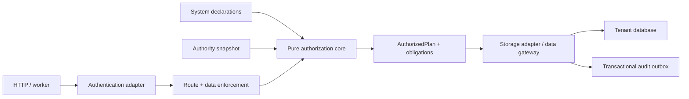

# Kiến trúc xác thực và phân quyền dùng lại được

> Cập nhật implementation 2026-10-13: runtime API mới theo [kế hoạch chuyển đổi](superpowers/plans/2026-10-13-single-product-transition.md) và ADR0008. Các trạng thái/spike tenant hoặc “chưa triển khai” trong bản thiết kế gốc bên dưới là lịch sử, không chứng nhận hay phủ nhận trạng thái runtime mới. Xem ledger chuyển đổi để biết bằng chứng và gates còn lại.

Ngày khởi tạo: 2026-10-12. Cập nhật: 2026-10-13. Trạng thái: đề xuất kiến trúc, chưa triển khai production.

Thiết kế độc lập, không đọc hoặc kế thừa mô hình phân quyền của repo. Các tên trong ví dụ chỉ thuộc cấu hình hệ thống minh họa. Spike trong `spikes/authz/` dùng dữ liệu tự tạo, không import ứng dụng, không dùng database hay thông tin đăng nhập của dự án.

## 1. Tóm tắt một trang

**Chọn một lõi quyết định thuần hàm: RBAC để gom quyền, ReBAC để suy phạm vi qua quan hệ giữa các resource/danh tính, ABAC để kiểm tra thuộc tính, ngoại lệ bản ghi để xử lý cấp/chặn riêng.** Kết quả không chỉ là boolean: lõi tạo một cây điều kiện có kiểu, để cùng một nghĩa được đánh giá trên một bản ghi hoặc biên dịch thành điều kiện truy vấn.

```text
Cho phép = ranh giới bắt buộc
           AND permission policy bắt buộc
           AND permission boundary hiệu lực của membership
           AND (có cấp theo vai trò/cá nhân/phạm vi OR có cấp bản ghi)
           AND NOT (có chặn theo vai trò/cá nhân/phạm vi/bản ghi)
```

Ranh giới bắt buộc gồm danh tính hợp lệ, thành viên đang hoạt động, tenant chính xác, tài nguyên đã đăng ký, cấu hình hợp lệ và các bất biến quản trị. Không có vai trò nào bỏ qua chúng. Cấp trên bản ghi có thể mở rộng phạm vi, không vượt tenant hoặc lệnh chặn.

**Permission policy** là hợp đồng có tên/version gắn với permission: yêu cầu context, điều kiện bắt buộc trên bản ghi và obligation. Nó kết hợp RBAC/ReBAC/ABAC trong một quyết định, áp dụng cả khi quyền đến từ record exception. Policy không tự tạo grant; một policy thỏa mãn nhưng không có allow vẫn bị từ chối.

**Permission boundary** là giới hạn tối đa gắn với membership cho permission đang sử dụng; không tự cấp quyền và áp dụng cả record allow. `ApplicationRoleBoundary` chỉ là ví dụ cấu hình, không phải khái niệm đặc thù trong lõi. Hợp đồng tổng quát, storage và test bổ sung nằm trong [Permission boundaries](permission-boundaries.md); phần này chưa được triển khai trong runtime.

**Lõi không biết NestJS, SQL, tên bảng, ORM hoặc tên domain.** Nó biết principal, tenant, action, resource reference, rule, expression và obligation. Adapter biết token, HTTP, transaction, database, cache và cách thực thi obligation. Mỗi hệ thống khai báo resource, action, template phạm vi, quan hệ, binding dữ liệu, role mặc định và chính sách quản trị.

**Phương án tham chiếu cô lập mỗi tenant bằng database và database credential riêng.** Vẫn có `tenant_id` và khóa ngoại ghép để chống liên kết nhầm. Lý do chọn phương án này: quên `WHERE tenant_id` trong MySQL không được biến thành đọc toàn bộ tenant khác. Một thư viện thuần trong ứng dụng không thể bảo đảm điều đó với một tài khoản SQL có quyền trên mọi tenant. Control plane danh tính nằm riêng, không cấp credential của nó cho code nghiệp vụ.

Tenant là một đơn vị cô lập phẳng. Tên và cấp tổ chức được cấu hình. Không có kế thừa quyền cha → con: các cấp bên trong một tenant là quan hệ phạm vi; các đơn vị cần cô lập thật sự là tenant khác nhau. Single-tenant vẫn có một tenant và cùng các bước kiểm tra.

ReBAC là phần khai báo chính thức: relation definition mô tả loại cạnh và hướng; relation tuple mô tả liên kết giữa những instance cụ thể. Server có thể khởi tạo/cập nhật definition và các tuple do code quản lý khi boot, trước readiness. Boot đồng bộ có version và transaction, không ghi đè các tuple phân công/điều trị do nghiệp vụ quản lý.

Mọi đường dữ liệu đi qua một data gateway nhận `AuthorizedPlan`, bao gồm list, detail, count, export và write. NestJS guard chỉ kiểm tra danh tính, route contract và mở context; không thay thế kiểm tra tại dữ liệu. Raw SQL được hỗ trợ qua template đã đăng ký, không cho handler truyền câu SQL tùy ý với credential chung.

Không cache quyết định cho phép hoặc membership ở phương án mặc định. Đọc authority từ primary; transaction giữ một tenant fence trong lúc đánh giá và thao tác. **Thu hồi tenant có hiệu lực tại commit: authorization bắt đầu sau commit không được dùng quyền cũ; write đã giữ fence phải kết thúc trước khi revoke commit.** Định nghĩa này không hứa thu hồi dữ liệu đã gửi. Chi phí và giới hạn request đang chạy ở mục 8.

Quản trị dùng hai điều kiện độc lập: có quyền quản lý và có thẩm quyền cao hơn người bị tác động. Cấm tự đổi quyền, tác động ngang cấp, cấp vượt phạm vi được phép ủy quyền, đổi định nghĩa hệ thống, và dùng quyền thành viên để thay danh tính toàn cục. Các điều kiện này nằm ngoài tập rule chỉnh được.

Đã có spike chạy trên MySQL 8.4 và PostgreSQL 17 với cùng file lõi; xem mục 15 và `spikes/authz/README.md`. Đây là bằng chứng cho tập biểu thức và primitive đã thử, không phải chứng nhận toàn bộ adapter production.

## 2. Mô hình khái niệm

| Khái niệm           | Định nghĩa và quan hệ                                                                                                                                                          |
| ------------------- | ------------------------------------------------------------------------------------------------------------------------------------------------------------------------------ |
| Identity            | Danh tính toàn cục, ID nội bộ ổn định. OIDC được ánh xạ bởi cặp `(issuer, subject)`, không bởi email. Không chứa role tenant trong token.                                      |
| Principal           | Identity đã được xác thực trong một session, hoặc service identity riêng cho job. Có assurance, thời điểm xác thực và hạn dùng.                                                |
| Tenant              | Ranh giới dữ liệu cứng; mỗi request chỉ hoạt động trong một tenant. Directory ánh xạ ID tenant đã kiểm chứng sang route kết nối.                                               |
| Membership          | Quan hệ `(tenant, identity)`, trạng thái hoạt động và thẩm quyền quản trị tại tenant đó. Cùng identity có nhiều membership độc lập.                                            |
| Role                | Tập rule tại một tenant. Người dùng có nhiều role; không có role inheritance ở bản đầu để tránh đồ thị khó kiểm soát.                                                          |
| Permission          | Cặp resource type + action, có key ổn định trong namespace ứng dụng. Tên hiển thị thay đổi được qua deploy; ngữ nghĩa đổi phải version key.                                    |
| Permission policy   | Hợp đồng bắt buộc của permission, có key/version: context requirements, required record scope và obligations. Mỗi permission trỏ chính xác một policy; thiếu binding thì deny. |
| Resource            | Loại tài nguyên đã khai báo và một instance có tenant, key có kiểu, object ID nội bộ. `read`, `update`, `approve` không tự suy ra lẫn nhau.                                    |
| Relation definition | Quan hệ có tên/version, resource nguồn, resource hoặc identity đích, hướng và storage binding. Ví dụ `submission.site: submission → site`. Được khai báo trong code.           |
| Relation tuple      | Một cạnh cụ thể `(tenant, source, relation@version, target)`, có thời gian hiệu lực và nguồn quản lý. Cạnh khác tenant luôn không hợp lệ.                                      |
| Scope               | Biểu thức điều kiện trên bản ghi, principal và quan hệ; không phải chuỗi SQL hay callback boolean tùy ý. `allWithinTenant` phải được khai báo rõ.                              |
| Rule                | Subject là một role hoặc identity; permission, effect allow/deny, template phạm vi và tham số có kiểu.                                                                         |
| Record exception    | Rule dành riêng một object: subject role/identity, action, effect, thời gian, người cấp, lý do. Luôn thuộc một tenant.                                                         |
| Authority level     | Trật tự quản trị, không tự cấp quyền dữ liệu. Mức hiệu lực là max của role được gán; membership lưu giá trị dẫn xuất để khóa/đọc.                                              |
| Permission boundary | Giới hạn bắt buộc của membership theo permission; typed scope/context nằm ngoài mọi grant. Không tự cấp quyền.                                                                 |
| Delegation envelope | Tập quyền và template/tham số một quản trị viên được phép cấp; hẹp hơn hoặc bằng khả năng được cấu hình để ủy quyền, không tự suy ra từ `read`.                                |
| Obligation          | Việc bắt buộc khi thực thi, ví dụ ghi audit khẩn cấp. Không thực hiện được thì không được trả dữ liệu.                                                                         |

Một membership bị đình chỉ vô hiệu hóa mọi role, direct grant và record exception của người đó tại tenant. Chặn quyền cá nhân được biểu diễn bằng deny rule với scope `allWithinTenant`; chặn có điều kiện cũng được hỗ trợ nhưng phải nêu rõ trong UI.

Object reference đầy đủ là `(tenantId, resourceType, keyKind, canonicalKey)`. Số nguyên truyền dưới dạng chuỗi thập phân chuẩn hoặc `bigint`, không qua JavaScript `number`; UUID chuẩn hóa ở codec; string giữ nguyên byte UTF-8, không trim hoặc đổi hoa/thường ngầm. ID `integer:42` khác `string:42`. Registry dùng object UUID riêng để exception không sống lại khi khóa nghiệp vụ bị tái sử dụng.

Giới hạn reference: key canonical tối đa 256 byte trong DDL tham chiếu. Hệ thống có khóa dài hơn phải cung cấp binding sang object UUID và kiểm chứng lookup không va chạm; không cắt chuỗi hoặc dùng hash không kiểm tra bản gốc.

## 3. Ranh giới, interface và extension point



| Thành phần                                                           | Thuộc đâu                                                                    | Phục vụ                       |
| -------------------------------------------------------------------- | ---------------------------------------------------------------------------- | ----------------------------- |
| Kiểu subject/rule/reference, precedence, mặc định deny, kiểm tra AST | Lõi                                                                          | N1–N5, N9, T1, T5, T10        |
| Bất biến quản trị, kiểm tra delegation theo template                 | Lõi; tham số do hệ thống khai báo                                            | T5–T8                         |
| Route discovery, global guard, HTTP error mapping                    | Adapter NestJS                                                               | N6, T1, T2, T9                |
| Credential tenant, compiler SQL, transaction/fence, FK               | Adapter lưu trữ                                                              | N1, N4, N8, N9, T1–T3, T9–T10 |
| OIDC/session và directory                                            | Adapter xác thực/control plane                                               | N2, T7, T9                    |
| Danh mục action/resource, role, relation, scope template             | Riêng từng hệ thống                                                          | N3–N6, D1–D3                  |
| Permission policy                                                    | Lõi kết hợp điều kiện; hệ thống khai báo; adapter thực thi scope/obligations | N4–N8, T5, T8–T10             |
| File/search/job/cache adapter                                        | Tùy chọn; bật khi hệ thống dùng kênh đó                                      | T4                            |
| Emergency activation                                                 | Extension có obligation, không mặc định bật                                  | D3, T5, T8                    |

Các interface là hợp đồng thiết kế, không phải SDK production:

```ts
type TenantId = string & { readonly tenantId: unique symbol };
type IdentityId = string & { readonly identityId: unique symbol };
type Key =
  | { kind: 'integer'; value: string }
  | { kind: 'uuid'; value: string }
  | { kind: 'string'; value: string };
type ResourceRef = { tenant: TenantId; type: string; key: Key };

type Expr =
  | { op: 'constant'; value: boolean }
  | { op: 'and' | 'or'; args: readonly Expr[] }
  | { op: 'not'; arg: Expr } // Only the core creates this node for deny combination.
  | { op: 'eq' | 'lt' | 'lte'; field: string; value: ValueRef }
  | { op: 'isNull'; field: string }
  | { op: 'exists'; relation: string; where: Expr };
type ValueRef =
  | { from: 'literal'; value: string | boolean | null }
  | { from: 'principal' | 'context' | 'parameter'; name: string };

interface AuthorizationCore {
  validate(declarations: SystemDeclarations): ValidationResult;
  plan(input: TrustedInput, snapshot: AuthoritySnapshot): Decision;
  evaluate(plan: AuthorizedPlan, facts: CompleteFacts): Decision;
  authorizeAdministration(command: AdminCommand, facts: AdminFacts): Decision;
}
type Decision =
  | { effect: 'deny'; internalReason: string }
  | { effect: 'allow'; plan: AuthorizedPlan; obligations: readonly Obligation[] };
interface AuthorizedPlan {
  readonly tenant: TenantId;
  readonly identity: IdentityId;
  readonly resource: string;
  readonly action: string;
  readonly revision: string;
  readonly predicate: Readonly<Expr>;
  readonly validUntil: string;
}

interface ScopeTemplate {
  key: string;
  version: number;
  parameterSchema: JsonSchema;
  expression: Expr;
  delegateSubset?: (candidate: CheckedParams, envelope: CheckedParams) => boolean;
}
type PolicyRef = { key: string; version: number };
interface PermissionPolicy {
  key: string;
  version: number;
  contextRequirements: readonly {
    validator: string;
    parameters: Readonly<Record<string, string | boolean>>;
  }[];
  requiredScope: Expr;
  obligations: readonly { handler: string }[];
}
interface ActionDeclaration {
  policy: PolicyRef;
}
interface ResourceDeclaration {
  key: string;
  keyCodec: KeyCodec;
  tenantBinding: string;
  fields: Readonly<Record<string, FieldType>>;
  relations: readonly RelationDeclaration[];
  actions: Readonly<Record<string, ActionDeclaration>>;
}
interface RelationDeclaration {
  key: string;
  version: number;
  sourceType: string;
  target: { kind: 'resource'; type: string } | { kind: 'identity' };
  binding: { kind: 'edgeStore' } | { kind: 'domain'; key: string };
}
interface ResourceRelationSeed {
  key: string;
  owner: string;
  relation: { key: string; version: number };
  source: ResourceRef;
  target: ResourceRef;
  startsAt: string;
  expiresAt?: string;
}
interface RelationBootstrapPort {
  reconcile(
    tenant: TenantId,
    release: VerifiedReleaseManifest,
  ): Promise<{
    changed: boolean;
    revision: string;
    manifestHash: string;
  }>;
}
interface StorageBinding {
  resource: string;
  compile(plan: AuthorizedPlan, tx: TenantTransaction): BoundPredicate;
  list(plan: AuthorizedPlan, query: ValidatedQuery, tx: TenantTransaction): Promise<Page>;
  detail(plan: AuthorizedPlan, key: Key, tx: TenantTransaction): Promise<Row | null>;
  mutate(plan: AuthorizedPlan, command: CheckedMutation, tx: TenantTransaction): Promise<Result>;
}
interface AuthenticationPort {
  verify(credential: IncomingCredential): Promise<VerifiedPrincipal>;
}
interface AuthorityPort {
  withSnapshot<T>(
    principal: VerifiedPrincipal,
    tenant: TenantId,
    mode: 'read' | 'write' | 'admin',
    run: (snapshot: AuthoritySnapshot, tx: TenantTransaction) => Promise<T>,
  ): Promise<T>;
}
```

`JsonSchema`, `TrustedInput`, `CompleteFacts` và các kiểu còn lại là DTO tại ranh giới, không phải ORM entities. Brand TypeScript chỉ chống lỗi lập trình, không phải cơ chế chống giả mạo. Plan thật do gateway tạo trong context riêng, không deserialize từ client; nếu qua process khác phải ký, kiểm tra audience, hash nội dung, revision và hạn dùng. Chữ ký không thay kiểm tra trạng thái hiện tại.

Extension relation chỉ ánh xạ tên quan hệ logic sang mapping có kiểu: trường nguồn/đích, cardinality, điều kiện hoạt động, khóa tenant hai phía. Extension template tạo AST qua operator đã hỗ trợ. Không được trả về `true` để bỏ qua tenant, gắn SQL tự do hoặc thực hiện HTTP trong lúc đánh giá. Thêm quan hệ/template không sửa lõi; thêm toán tử mới có ngữ nghĩa mới thì phải version lõi và cả adapter — không tuyên bố hỗ trợ mọi policy tùy ý.

Node `not` chỉ do lõi tạo khi kết hợp deny, không chấp nhận từ template người quản trị. Literal số/decimal trong ValueRef dùng chuỗi chuẩn nhưng luôn được parse/bind theo FieldType; đó không phải phép so sánh chuỗi cho amount. Mọi template và callback subset là code đã review của hệ thống, không phải JavaScript do người quản trị tải lên.

Field type phân biệt integer, decimal chính xác, money có currency, string, timestamp và nullable. Null là giá trị dữ liệu; thiếu field/binding là lỗi cấu hình. Với grant, comparison null không khớp. Với deny, template phải có nhánh null rõ ràng hoặc dùng field `NOT NULL`; compiler từ chối deny có giá trị không xác định. Không dùng JavaScript coercion, SQL collation mặc định hay `NULL != x` để quyết định quyền.

### 3.1 ReBAC: định nghĩa quan hệ và suy phạm vi

```ts
const relations: RelationDeclaration[] = [
  {
    key: 'submission.site',
    version: 1,
    sourceType: 'submission',
    target: { kind: 'resource', type: 'site' },
    binding: { kind: 'edgeStore' },
  },
  {
    key: 'site.manager',
    version: 1,
    sourceType: 'site',
    target: { kind: 'identity' },
    binding: { kind: 'domain', key: 'siteManagers' },
  },
];

const managedSite: Expr = {
  op: 'exists',
  relation: 'submission.site@1',
  where: {
    op: 'exists',
    relation: 'site.manager@1',
    where: {
      op: 'eq',
      field: 'identityId',
      value: { from: 'principal', name: 'id' },
    },
  },
};
```

Nghĩa của biểu thức: từ submission hiện tại, đi theo cạnh `submission.site` tới một site, rồi tìm cạnh `site.manager` tới principal hiện tại. Mỗi `where` đổi context sang đích của cạnh đó; các field được kiểm tra theo kiểu đích. Adapter dịch cùng AST thành các `EXISTS` lồng nhau, kiểm tra tenant và thời hạn trên **mọi cạnh**, không chỉ resource ngoài cùng.

Cạnh có hướng, không tự tạo cạnh ngược hoặc quyền ngược. Có cạnh `submission → site` không tự cấp quyền đọc site hoặc submission; chỉ permission khai báo biểu thức đó mới dùng nó. Deny trên resource đích cũng không ngầm lan truyền qua đồ thị: nếu hệ thống muốn cấm toàn bộ dữ liệu dưới một site, khai báo deny scope cho từng permission con dựa trên cùng quan hệ. Deny của action đang kiểm tra vẫn thắng mọi grant theo ReBAC.

Path khai báo hữu hạn, tối đa 8 bước ở profile tham chiếu; compiler kiểm tra type nối tiếp, version và operator trước readiness. Từ chối policy reference có vòng lặp hoặc path vượt giới hạn; không chạy đệ quy không giới hạn, không cắt graph tại runtime rồi vô tình bỏ sót deny. Dữ liệu có cycle vẫn có thể tồn tại nếu domain cho phép vì truy vấn chỉ đi theo path hữu hạn. Cạnh đang hết hạn/bị xóa không tham gia scope; thay đổi cạnh dùng cùng fence/revision và audit như thay đổi quyền.

Lõi sở hữu ngữ nghĩa traversal; adapter sở hữu joins/EXISTS và transaction; hệ thống khai báo tên/type/binding/path. Không đưa `submission`, `site` hoặc một quan hệ đặc thù nào vào lõi. Các ví dụ domain có thể dùng FK nghiệp vụ làm binding thay cho edge store, giữ nguyên nghĩa ReBAC và không nhân đôi nguồn dữ liệu.

## 4. Thuật toán, xung đột và mặc định

### 4.1 Cơ chế permission policy

Phân biệt ba phần để không có hai engine cấp quyền cạnh tranh:

- **Grant/deny rule:** role, identity hoặc exception được cấp/chặn action nào, trong scope nào. Tiếp tục dùng `policy_rule`, `scope_template`, `record_exception` đã có.
- **Permission policy:** điều kiện mà mọi đường cấp quyền của action đó phải đạt. Ví dụ approve đòi MFA và trạng thái chờ duyệt; threshold theo chức danh vẫn là scope của grant.
- **Hard invariants:** tenant, membership và bất biến quản trị luôn do lõi ép buộc; policy không thay đổi được chúng.

```ts
const approvePolicy: PermissionPolicy = {
  key: 'contract-approval',
  version: 1,
  contextRequirements: [
    { validator: 'minimumAssurance@1', parameters: { minimum: '2' } },
  ],
  requiredScope: {
    op: 'eq', field: 'status',
    value: { from: 'literal', value: 'pending' },
  },
  obligations: [{ handler: 'auditBeforeCommit@1' }],
};

const contractActions = {
  approve: { policy: { key: 'contract-approval', version: 1 } },
};

@Post(':id/approve')
@Authorize({ resource: 'contract', action: 'approve',
  policy: { key: 'contract-approval', version: 1 },
  defaults: [{ role: 'head', scope: 'belowApprovalLimit@1' }] })
approve() { /* gateway.mutate(context, 'contract', 'approve', command) */ }
```

Contract resource của ví dụ này khai báo thêm field `status` có kiểu enum và binding tương ứng. Khai báo tại endpoint phải khớp resource/action catalog; gateway luôn tự resolve policy từ catalog, không tin policy key truyền bởi request. Job/internal service đi qua cùng gateway nên không thể bỏ policy chỉ vì không có decorator HTTP. `PolicyRef` tại decorator là assertion được CI/startup đối chiếu, không phải tùy chọn thay policy của action.

`contextRequirements` là danh sách validator đã đăng ký/version trong adapter, chỉ đọc facts context tin cậy như assurance từ session đã xác minh. Chúng không cấp quyền, không đọc từng bản ghi và không gọi HTTP trong transaction. `false` thì deny; thiếu validator/fact hoặc exception không bao giờ trở thành allow. Lỗi hạ tầng map sang unavailable; không gửi chi tiết nội bộ cho client. Điều kiện phụ thuộc record phải nằm trong `requiredScope` và compile được thành query, không giấu trong callback context.

`requiredScope` là điều kiện AND bên ngoài mọi grant. Grant scope không khớp có thể được record allow mở rộng; required scope thì không. Dùng `constant: true` tường minh cho permission không có ràng buộc bổ sung. Không đặt `treatingNow` thành required scope của `clinicalRecord.read` nếu emergency cần mở rộng quan hệ điều trị; giữ nó ở grant của doctor, còn tenant/MFA/audit theo chính sách phù hợp.

Với read/update/delete, required scope chọn bản ghi ở trạng thái **trước thao tác**; với create, kiểm tra candidate đã được server chuẩn hóa. Sau mutation, domain kiểm tra transition và các bất biến trạng thái đích trong cùng transaction. Ví dụ approve kiểm tra `pending` trước, rồi chuyển sang `approved`; không áp lại điều kiện `pending` lên trạng thái sau. Những field bảo mật đổi phải được command adapter kiểm chứng riêng theo mục 5.3/9.

`obligations` sử dụng registry handler đã version, luôn được kiểm chứng khi boot. Obligation chung của permission áp dụng dù allow đến từ role, direct grant hay exception; nghĩa vụ riêng của nhánh emergency cũng phải được hợp nhất và không được bỏ. Không hỗ trợ handler tùy ý do tenant admin upload. Mutation audit nằm trong transaction trước commit; read audit bắt buộc được ghi bền vững trước trả payload. Không trả dữ liệu rồi mới coi audit thất bại là cảnh báo.

Mỗi permission có một policy bắt buộc. Muốn kết hợp nhiều điều kiện dùng `and/or` trong cùng AST, context requirements đều AND, obligations hợp nhất theo handler; không có `first-match`, priority số hay `skipPolicy`. Không hỗ trợ inheritance policy ở bản đầu. Nhiều permission có thể dùng cùng policy nếu type-check và compiler xác nhận tương thích với từng resource.

Các permission không cần ràng buộc riêng trỏ tường minh tới `baseline@1` với requirements/obligations rỗng và required scope true. Baseline vẫn không bỏ hard invariants hoặc yêu cầu grant. Những khai báo domain và endpoint rút gọn ở các mục khác phải bổ sung binding baseline hoặc policy cụ thể khi đưa vào manifest; không có default baseline ngầm để che lỗi thiếu cấu hình.

### 4.2 Đánh giá và thứ tự ưu tiên

```text
authorize(request):
  authenticate credential; reject if invalid/expired/revoked
  resolve one tenant from validated routing; never from untrusted entity body
  open tenant authority transaction, acquire fence with defined lock mode
  load active membership, current roles/rules, exact manifest/revision
  validate registered resource, action, fields, relations and storage binding
  enforce hard invariants (tenant, membership, admin safety, assurance)
  resolve exact permission policy key/version from current catalog
  validate policy availability, typed bindings and obligation handlers
  require ALL policy context requirements to pass using trusted facts
  if any fact required for a decision is unavailable: deny/unavailable

  resolve boundary requirement and membership binding for this permission
  reject missing required binding or invalid boundary/version/entry
  require boundary context requirements using trusted facts
  B = bound boundary.requiredScope, or true only for optional + no binding

  rules = matching permission and subject, active at trusted decision time
  A = OR(each allow rule's scope, each applicable record allow)
  D = OR(each deny rule's scope, each applicable record deny)
  P = tenantEquals(context.tenant) AND resourceTypeEquals(request.type)
      AND policy.requiredScope AND B AND A AND NOT D

  create plan bound to identity, tenant, action, revision, transaction, expiry
  execute requested read/write with P at data gateway
  fulfill mandatory obligations before releasing result/committing effect
```

Đối với truy vấn tập, `Decision.allow` nghĩa là có một kế hoạch truy vấn hợp lệ, không phải cho phép tất cả bản ghi. `detail` thêm điều kiện key vào cùng `P`. Guard không được từ chối chỉ vì thiếu role grant nếu còn record allow hợp lệ; cũng không được coi có một role grant là đủ quyền toàn bộ dữ liệu.

| Xung đột                                                 | Kết quả                                            |
| -------------------------------------------------------- | -------------------------------------------------- |
| Tenant sai + mọi loại allow, kể cả emergency             | Deny                                               |
| Membership suspended + record allow                      | Deny                                               |
| Policy thiếu/sai version, context requirement thất bại   | Deny; thiếu cấu hình còn làm CI/startup fail       |
| Policy requiredScope không khớp + record allow           | Deny                                               |
| Policy đạt + không có grant                              | Deny                                               |
| Mọi điều kiện đạt nhưng obligation bắt buộc thất bại     | Không commit effect/không trả payload              |
| Role allow + personal deny                               | Deny trong phạm vi deny                            |
| Personal allow + role deny                               | Deny trong phạm vi deny                            |
| Hai role, một allow một deny                             | Deny tại bản ghi khớp deny                         |
| Scope không khớp + record allow                          | Allow nếu mọi ranh giới khác đạt                   |
| Record allow + record deny, dù khác subject              | Deny                                               |
| Không có allow                                           | Deny                                               |
| Scope/action/resource/binding chưa khai báo              | CI/startup lỗi; runtime deny, không mặc định `all` |
| Exception hết hạn/bị revoke hoặc role không còn được gán | Không tham gia quyết định                          |

Không có quy tắc “cụ thể hơn thắng”, “bản ghi thắng toàn cục”, hoặc “user thắng role”. Có thể giải thích bằng `matchedRuleIds`, `revision`, `reasonCode` trong audit; không gửi lý do về tenant/record không được thấy cho client.

Emergency allow cũng theo precedence này. Nó kích hoạt một khả năng đã cấp trước, không phải quyền tự tạo rule mới. Nếu cần break-glass vượt một deny nghiệp vụ, phải thiết kế lại phân loại deny và phê duyệt rõ; bản tham chiếu **không cho phép**.

## 5. Nơi ép kiểm tra và tính nhất quán dữ liệu

### 5.1 Xác thực và context

Adapter OIDC dùng Authorization Code + PKCE cho client tương tác. Ràng buộc issuer/audience/algorithm, chữ ký, expiry, nonce/state và redirect URI; dùng thư viện giao thức đã duy trì, không tự viết crypto. RFC 8725 yêu cầu lựa chọn thuật toán tin cậy và kiểm tra audience phù hợp; xem [JWT Best Current Practices](https://www.rfc-editor.org/rfc/rfc8725.html).

Sau login, đổi sang session opaque ngẫu nhiên; DB chỉ lưu hash token. Session cookie dùng Secure/HttpOnly và CSRF protection cho request thay đổi trạng thái. API bearer token có audience riêng; không dùng ID token làm authorization token. Refresh rotation/reuse detection thuộc identity provider/session adapter. MFA/reauth bắt buộc cho thao tác quản trị nhạy cảm và emergency nếu hệ thống bật.

Danh sách tenant của chính người đăng nhập lấy qua control plane có kiểm chứng membership; không có endpoint công khai enumerate directory. Client có thể chọn tenant trong route, nhưng đó chỉ là yêu cầu: server kiểm chứng membership trước khi chọn pool. Token không cung cấp nguồn role có thẩm quyền. Đổi tenant tạo context mới; không mutate context dùng chung, không dựa vào biến global hoặc ambient context duy nhất.

### 5.2 Cô lập vật lý và chỗ SQL thô được phép

Mỗi tenant có database credential chỉ được truy cập database của tenant đó, không được `CREATE`, `GRANT`, đọc control plane hoặc đổi anchor. Pool keyed theo `(deployment, tenantId, credentialVersion)`; không dùng một user toàn quyền rồi chạy `USE <tenant from header>`. TenantContext chỉ do resolver tạo. Với yêu cầu bảo vệ khỏi code extension độc hại, gateway phải là process riêng, credential không nằm trong NestJS process; TypeScript không phải sandbox.

MySQL không cung cấp cơ chế policy RLS kiểu PostgreSQL trong thiết kế này; isolation tham chiếu dùng database privilege và anchor/FK. PostgreSQL cũng dùng database/user theo tenant để giữ cùng mức bảo đảm. Có thể thêm RLS ở PostgreSQL nhưng nó không thay thế kiểm tra quan hệ và error mapping: owner/BYPASSRLS và kiểm tra toàn vẹn có ngoại lệ; xem [PostgreSQL row security](https://www.postgresql.org/docs/17/ddl-rowsecurity.html).

Quên predicate tenant trong một query chạy bằng tenant credential vẫn không đọc được database khác. Chọn nhầm credential/pool là lỗi trong adapter tin cậy, phải bắt bằng contract test, không thể được lõi thuần tự phát hiện từ kết quả rỗng. Các bảng tenant mới phải có FK về `tenant_anchor`; schema linter phát hiện bảng không khai báo classification tenant/global.

| Đường truy cập | Điểm tích hợp bắt buộc                                                                                         | Không được làm                                                                |
| -------------- | -------------------------------------------------------------------------------------------------------------- | ----------------------------------------------------------------------------- |
| ORM bất kỳ     | Adapter nhận plan và transaction, xây điều kiện/query từ AST; repository tenant-bound                          | `findById` không plan, lazy relation load ngoài context                       |
| Query builder  | Gắn predicate cuối cùng ở gateway; mọi join/alias đã đăng ký                                                   | Handler gọi `.where()` sau đó làm mất điều kiện quyền                         |
| Raw SQL        | Template registered, slot predicate và aliases do adapter sở hữu; value bind parameter                         | Ghép chuỗi từ request, callback trả arbitrary SQL, kiểm tra tenant bằng regex |
| Search         | Index tenant riêng; candidate IDs phải recheck DB plan trước trả kết quả/snippet/facet                         | Tin ACL trong index cũ hoặc trả total của candidate chưa lọc                  |
| File           | Object metadata có tenant/reference; authorize từng download qua proxy                                         | URL công khai hoặc signed URL dài hơn chính sách revoke                       |
| Worker         | Envelope ký gồm tenant, initiating identity/service principal, action, refs; reauthorize lúc chạy và mỗi chunk | Tin role/plan đã serialize lúc enqueue                                        |

Framework guard không thể cứu query chạy qua một credential ngoài gateway. Hệ thống cố ý cấp raw tenant DB connection cho handler vẫn giữ được tenant isolation, nhưng **không còn bảo đảm record scope**. Chế độ đó không đạt chứng nhận tích hợp. Shared DB với shared privileged credential cũng không đáp ứng T10 bằng MySQL + thư viện ứng dụng đơn thuần.

### 5.3 List, detail, aggregate và write

```sql
-- Cùng P cho mọi hình thức đọc, giá trị đều là bind parameter.
SELECT <projection> FROM <resource> r
WHERE P AND <user_filter>
ORDER BY <allowed_order>, <stable_key> LIMIT <bounded_page_size>;

SELECT <projection> FROM <resource> r WHERE P AND r.<key> = <key>;
SELECT COUNT(*) FROM <resource> r WHERE P AND <user_filter>;
```

P dùng `EXISTS`/`NOT EXISTS` cho relation/exception thay vì tải toàn bộ ID được phép vào bộ nhớ. Query scope chạy trước pagination, aggregate, search ranking có thể lộ thông tin và export. Projection là allowlist riêng; có quyền đọc bản ghi không tự có quyền đọc mọi cột. Join tới resource độc lập phải áp plan của resource đó hoặc quan hệ khai báo rõ projection an toàn.

List và detail nhất quán ở **cùng principal, tenant, action, policy revision và snapshot dữ liệu**. Hai request cách nhau có thể khác do phân công/quyền thay đổi; không có hệ thống mutable nào đảm bảo hai thời điểm luôn trả cùng kết quả. List trả các affordance update/approve thì tính theo action tương ứng, không lấy `read` suy ra.

Create kiểm tra candidate sau khi server gán tenant/creator, các reference liên quan đã authorize và tồn tại trong cùng tenant. Update kiểm tra trạng thái trước và sau, danh sách field được đổi và transition policy. Không cho người dùng đổi owner/amount/site/tenant rồi dùng chính giá trị mới để hợp thức hóa thao tác. `tenant_id` bất biến; chuyển tenant là quy trình riêng ngoài bản đầu. Bulk operation giới hạn số bản ghi, authorize từng target trong một transaction hoặc chunk có kết quả tường minh.

### 5.4 Race, lock và deadlock

Phương án đúng trước, tối ưu sau: một hàng `authz_fence` trên mỗi tenant. Request dữ liệu lấy shared lock; mọi thay đổi membership, role, deny, exception, relation hay attribute được dùng trong policy lấy exclusive lock **trước khi đọc facts**. Exclusive transaction tăng revision. Ordinary write không đổi facts bảo mật giữ shared fence rồi khóa bản ghi để chống lost update. Kế hoạch ghi phải dùng trong transaction tạo ra nó.

Thứ tự toàn hệ thống: `tenant fence → membership/role theo key tăng dần → object theo (type, canonical key) → relation/exception → audit`. Không nâng shared lock lên exclusive: phân loại command trước transaction. Bulk admin và role edit khóa và kiểm tra toàn bộ tập thành viên bị ảnh hưởng; dữ liệu chưa đủ thì từ chối. Không HTTP, file upload hoặc publish queue trực tiếp trong transaction; dùng outbox.

MySQL adapter đặt READ COMMITTED rõ ràng, không dựa vào mặc định REPEATABLE READ; sau khi lấy fence mới đọc facts. Lock outer query không tự khóa rows trong subquery, nên protocol fence phải áp dụng cho **mọi writer** của facts, không chỉ vài endpoint. Đây là giới hạn được mô tả trong [MySQL 8.4 locking reads](https://dev.mysql.com/doc/refman/8.4/en/innodb-locking-reads.html). PostgreSQL READ COMMITTED có snapshot theo statement; fence ngăn authority facts đổi giữa các statement của thao tác. Xem [PostgreSQL transaction isolation](https://www.postgresql.org/docs/17/transaction-iso.html).

Đối với list có count riêng cần cùng snapshot bản ghi: dùng một query window count hoặc transaction snapshot phù hợp, không hứa count/read nhất quán nếu hai statement đọc snapshot khác nhau. Giá trị scope nhạy cảm dùng primary; replica không tham gia quyết định.

Retry toàn transaction tối đa 2 lần với jitter cho MySQL 1213/1205 và PostgreSQL 40P01/40001/55P03; vẫn lỗi thì 409 cho xung đột retry được hoặc 503 cho authority unavailable. Không tiếp tục transaction sau lỗi và không bỏ qua khóa. Side effect có idempotency key thuộc tenant. Shared tenant fence đơn giản nhưng làm thay đổi relation/policy serialize; đây là đánh đổi có chủ ý, không phải tuyên bố scale vô hạn.

## 6. Schema lưu trữ và khác biệt DB

Identity database chứa identity, external identity mapping, session và directory. Tenant database chứa membership và toàn bộ policy/data refs của tenant đó. Không có foreign key xuyên database tới identity: adapter membership xác minh identity qua control plane; định danh bất biến, suspend thay vì hard-delete. Việc ngắt global identity được kiểm tra khi authenticate mỗi request.

DDL dưới đây là schema đầy đủ của lớp authn/authz tham chiếu, không bao gồm bảng nghiệp vụ của D1–D3. Tên DB và tenant ID là fixture; provisioning thay bằng ID tenant thật và credential riêng. `tenant_anchor` chỉ migration principal được ghi. Tất cả thời gian là UTC với microsecond; app/adapter validate trước DB.

```sql
-- Design DDL, synthetic database names. Run only in the disposable spike container.
CREATE DATABASE authz_design_identity CHARACTER SET utf8mb4 COLLATE utf8mb4_0900_bin;
USE authz_design_identity;

CREATE TABLE identity_record (
  id BINARY(16) PRIMARY KEY,
  state VARCHAR(16) NOT NULL CHECK (state IN ('active','disabled')),
  revision BIGINT NOT NULL DEFAULT 1 CHECK (revision > 0),
  created_at DATETIME(6) NOT NULL
) ENGINE=InnoDB;

CREATE TABLE federated_identity (
  issuer VARBINARY(255) NOT NULL,
  subject VARBINARY(255) NOT NULL,
  identity_id BINARY(16) NOT NULL,
  PRIMARY KEY (issuer, subject),
  KEY ix_federation_identity (identity_id),
  FOREIGN KEY (identity_id) REFERENCES identity_record(id)
) ENGINE=InnoDB;

CREATE TABLE auth_session (
  token_hash BINARY(32) PRIMARY KEY,
  identity_id BINARY(16) NOT NULL,
  assurance SMALLINT NOT NULL CHECK (assurance BETWEEN 0 AND 10),
  expires_at DATETIME(6) NOT NULL,
  revoked_at DATETIME(6) NULL,
  created_at DATETIME(6) NOT NULL,
  KEY ix_session_identity (identity_id, revoked_at),
  KEY ix_session_expiry (expires_at),
  FOREIGN KEY (identity_id) REFERENCES identity_record(id)
) ENGINE=InnoDB;

CREATE TABLE tenant_directory (
  id BINARY(16) PRIMARY KEY,
  display_label VARCHAR(120) NOT NULL,
  route_ref VARBINARY(128) NOT NULL UNIQUE,
  state VARCHAR(16) NOT NULL CHECK (state IN ('active','disabled'))
) ENGINE=InnoDB;

CREATE DATABASE authz_design_tenant CHARACTER SET utf8mb4 COLLATE utf8mb4_0900_bin;
USE authz_design_tenant;

CREATE TABLE tenant_anchor (
  tenant_id BINARY(16) PRIMARY KEY,
  CONSTRAINT ck_single_tenant CHECK (tenant_id = X'00000000000000000000000000000001')
) ENGINE=InnoDB;
INSERT INTO tenant_anchor VALUES (X'00000000000000000000000000000001');

CREATE TABLE authz_fence (
  tenant_id BINARY(16) PRIMARY KEY,
  revision BIGINT NOT NULL DEFAULT 1 CHECK (revision > 0),
  manifest_hash BINARY(32) NOT NULL,
  release_sequence BIGINT NOT NULL DEFAULT 0 CHECK (release_sequence >= 0),
  FOREIGN KEY (tenant_id) REFERENCES tenant_anchor(tenant_id)
) ENGINE=InnoDB;

CREATE TABLE membership (
  tenant_id BINARY(16) NOT NULL,
  identity_id BINARY(16) NOT NULL,
  state VARCHAR(16) NOT NULL CHECK (state IN ('active','suspended')),
  authority_level SMALLINT NOT NULL DEFAULT 0 CHECK (authority_level BETWEEN 0 AND 1000),
  protected BOOLEAN NOT NULL DEFAULT FALSE CHECK (protected IN (0,1)),
  PRIMARY KEY (tenant_id, identity_id),
  FOREIGN KEY (tenant_id) REFERENCES tenant_anchor(tenant_id)
) ENGINE=InnoDB;

CREATE TABLE resource_type (
  tenant_id BINARY(16) NOT NULL,
  type_key VARBINARY(96) NOT NULL,
  key_kind VARCHAR(16) NOT NULL CHECK (key_kind IN ('integer','uuid','string')),
  binding_key VARBINARY(128) NOT NULL,
  PRIMARY KEY (tenant_id, type_key),
  FOREIGN KEY (tenant_id) REFERENCES tenant_anchor(tenant_id)
) ENGINE=InnoDB;

CREATE TABLE permission_policy (
  tenant_id BINARY(16) NOT NULL,
  policy_key VARBINARY(128) NOT NULL,
  policy_version INTEGER NOT NULL CHECK (policy_version > 0),
  definition_hash BINARY(32) NOT NULL,
  definition JSON NOT NULL,
  lifecycle VARCHAR(16) NOT NULL CHECK (lifecycle IN ('active','deprecated','retired')),
  PRIMARY KEY (tenant_id, policy_key, policy_version),
  FOREIGN KEY (tenant_id) REFERENCES tenant_anchor(tenant_id)
) ENGINE=InnoDB;

CREATE TABLE permission_catalog (
  tenant_id BINARY(16) NOT NULL,
  permission_key VARBINARY(160) NOT NULL,
  type_key VARBINARY(96) NOT NULL,
  action_key VARBINARY(64) NOT NULL,
  policy_key VARBINARY(128) NOT NULL,
  policy_version INTEGER NOT NULL,
  lifecycle VARCHAR(16) NOT NULL CHECK (lifecycle IN ('active','deprecated','retired')),
  PRIMARY KEY (tenant_id, permission_key),
  UNIQUE KEY uq_permission_action (tenant_id, type_key, action_key),
  UNIQUE KEY uq_permission_type (tenant_id, permission_key, type_key),
  FOREIGN KEY (tenant_id, type_key) REFERENCES resource_type(tenant_id, type_key),
  FOREIGN KEY (tenant_id, policy_key, policy_version)
    REFERENCES permission_policy(tenant_id, policy_key, policy_version)
) ENGINE=InnoDB;

CREATE TABLE scope_template (
  tenant_id BINARY(16) NOT NULL,
  template_key VARBINARY(128) NOT NULL,
  version INTEGER NOT NULL CHECK (version > 0),
  definition_hash BINARY(32) NOT NULL,
  PRIMARY KEY (tenant_id, template_key, version),
  FOREIGN KEY (tenant_id) REFERENCES tenant_anchor(tenant_id)
) ENGINE=InnoDB;

CREATE TABLE role_definition (
  tenant_id BINARY(16) NOT NULL,
  role_key VARBINARY(96) NOT NULL,
  managed_by VARCHAR(16) NOT NULL CHECK (managed_by IN ('code','tenant')),
  authority_level SMALLINT NOT NULL CHECK (authority_level BETWEEN 0 AND 1000),
  label VARCHAR(120) NOT NULL,
  PRIMARY KEY (tenant_id, role_key),
  FOREIGN KEY (tenant_id) REFERENCES tenant_anchor(tenant_id)
) ENGINE=InnoDB;

CREATE TABLE member_role (
  tenant_id BINARY(16) NOT NULL,
  identity_id BINARY(16) NOT NULL,
  role_key VARBINARY(96) NOT NULL,
  PRIMARY KEY (tenant_id, identity_id, role_key),
  KEY ix_role_members (tenant_id, role_key, identity_id),
  FOREIGN KEY (tenant_id, identity_id) REFERENCES membership(tenant_id, identity_id),
  FOREIGN KEY (tenant_id, role_key) REFERENCES role_definition(tenant_id, role_key)
) ENGINE=InnoDB;

CREATE TABLE policy_rule (
  tenant_id BINARY(16) NOT NULL,
  rule_id BINARY(16) NOT NULL,
  permission_key VARBINARY(160) NOT NULL,
  identity_id BINARY(16) NULL,
  role_key VARBINARY(96) NULL,
  effect VARCHAR(8) NOT NULL CHECK (effect IN ('allow','deny')),
  template_key VARBINARY(128) NOT NULL,
  template_version INTEGER NOT NULL,
  parameters JSON NOT NULL,
  managed_by VARCHAR(16) NOT NULL CHECK (managed_by IN ('code','tenant')),
  PRIMARY KEY (tenant_id, rule_id),
  CHECK ((identity_id IS NOT NULL AND role_key IS NULL) OR
         (identity_id IS NULL AND role_key IS NOT NULL)),
  KEY ix_rule_identity (tenant_id, permission_key, identity_id, effect),
  KEY ix_rule_role (tenant_id, permission_key, role_key, effect),
  FOREIGN KEY (tenant_id, permission_key) REFERENCES permission_catalog(tenant_id, permission_key),
  FOREIGN KEY (tenant_id, identity_id) REFERENCES membership(tenant_id, identity_id),
  FOREIGN KEY (tenant_id, role_key) REFERENCES role_definition(tenant_id, role_key),
  FOREIGN KEY (tenant_id, template_key, template_version)
    REFERENCES scope_template(tenant_id, template_key, version)
) ENGINE=InnoDB;

CREATE TABLE object_ref (
  tenant_id BINARY(16) NOT NULL,
  object_id BINARY(16) NOT NULL,
  type_key VARBINARY(96) NOT NULL,
  key_kind VARCHAR(16) NOT NULL CHECK (key_kind IN ('integer','uuid','string')),
  key_bytes VARBINARY(256) NOT NULL,
  PRIMARY KEY (tenant_id, object_id),
  UNIQUE KEY uq_object_key (tenant_id, type_key, key_kind, key_bytes),
  UNIQUE KEY uq_object_type (tenant_id, object_id, type_key),
  FOREIGN KEY (tenant_id, type_key) REFERENCES resource_type(tenant_id, type_key)
) ENGINE=InnoDB;

CREATE TABLE record_exception (
  tenant_id BINARY(16) NOT NULL,
  exception_id BINARY(16) NOT NULL,
  object_id BINARY(16) NOT NULL,
  type_key VARBINARY(96) NOT NULL,
  permission_key VARBINARY(160) NOT NULL,
  identity_id BINARY(16) NULL,
  role_key VARBINARY(96) NULL,
  effect VARCHAR(8) NOT NULL CHECK (effect IN ('allow','deny')),
  purpose VARCHAR(16) NOT NULL CHECK (purpose IN ('manual','emergency')),
  starts_at DATETIME(6) NOT NULL,
  expires_at DATETIME(6) NULL,
  reason VARCHAR(1000) NOT NULL CHECK (CHAR_LENGTH(TRIM(reason)) > 0),
  issued_by BINARY(16) NOT NULL,
  revoked_at DATETIME(6) NULL,
  PRIMARY KEY (tenant_id, exception_id),
  CHECK ((identity_id IS NOT NULL AND role_key IS NULL) OR
         (identity_id IS NULL AND role_key IS NOT NULL)),
  CHECK (expires_at IS NULL OR expires_at > starts_at),
  CHECK (purpose <> 'emergency' OR (expires_at IS NOT NULL AND effect = 'allow' AND identity_id IS NOT NULL)),
  KEY ix_exception_identity (tenant_id, permission_key, identity_id, object_id),
  KEY ix_exception_role (tenant_id, permission_key, role_key, object_id),
  KEY ix_exception_expiry (tenant_id, expires_at),
  FOREIGN KEY (tenant_id, object_id, type_key) REFERENCES object_ref(tenant_id, object_id, type_key) ON DELETE CASCADE,
  FOREIGN KEY (tenant_id, permission_key, type_key) REFERENCES permission_catalog(tenant_id, permission_key, type_key),
  FOREIGN KEY (tenant_id, identity_id) REFERENCES membership(tenant_id, identity_id),
  FOREIGN KEY (tenant_id, role_key) REFERENCES role_definition(tenant_id, role_key),
  FOREIGN KEY (tenant_id, issued_by) REFERENCES membership(tenant_id, identity_id)
) ENGINE=InnoDB;

CREATE TABLE resource_relation_definition (
  tenant_id BINARY(16) NOT NULL,
  relation_key VARBINARY(96) NOT NULL,
  relation_version INTEGER NOT NULL CHECK (relation_version > 0),
  source_type VARBINARY(96) NOT NULL,
  target_type VARBINARY(96) NOT NULL,
  binding_kind VARCHAR(16) NOT NULL CHECK (binding_kind IN ('edgeStore','domain')),
  binding_key VARBINARY(128) NOT NULL,
  definition_hash BINARY(32) NOT NULL,
  lifecycle VARCHAR(16) NOT NULL CHECK (lifecycle IN ('active','deprecated','retired')),
  PRIMARY KEY (tenant_id, relation_key, relation_version),
  UNIQUE KEY uq_relation_types (tenant_id, relation_key, relation_version, source_type, target_type),
  FOREIGN KEY (tenant_id, source_type) REFERENCES resource_type(tenant_id, type_key),
  FOREIGN KEY (tenant_id, target_type) REFERENCES resource_type(tenant_id, type_key)
) ENGINE=InnoDB;

CREATE TABLE relation_edge (
  tenant_id BINARY(16) NOT NULL,
  relation_key VARBINARY(96) NOT NULL,
  relation_version INTEGER NOT NULL,
  source_object BINARY(16) NOT NULL,
  source_type VARBINARY(96) NOT NULL,
  target_object BINARY(16) NOT NULL,
  target_type VARBINARY(96) NOT NULL,
  starts_at DATETIME(6) NOT NULL,
  expires_at DATETIME(6) NULL,
  seed_owner VARBINARY(128) NULL,
  seed_key VARBINARY(128) NULL,
  PRIMARY KEY (tenant_id, relation_key, relation_version, source_object, target_object),
  UNIQUE KEY uq_relation_seed (tenant_id, seed_owner, seed_key),
  KEY ix_edge_target (tenant_id, relation_key, relation_version, target_object, source_object),
  CHECK (expires_at IS NULL OR expires_at > starts_at),
  CHECK ((seed_owner IS NULL AND seed_key IS NULL) OR
         (seed_owner IS NOT NULL AND seed_key IS NOT NULL)),
  FOREIGN KEY (tenant_id, relation_key, relation_version, source_type, target_type)
    REFERENCES resource_relation_definition(tenant_id, relation_key, relation_version, source_type, target_type),
  FOREIGN KEY (tenant_id, source_object, source_type)
    REFERENCES object_ref(tenant_id, object_id, type_key) ON DELETE CASCADE,
  FOREIGN KEY (tenant_id, target_object, target_type)
    REFERENCES object_ref(tenant_id, object_id, type_key) ON DELETE CASCADE
) ENGINE=InnoDB;

CREATE TABLE identity_relation (
  tenant_id BINARY(16) NOT NULL,
  relation_key VARBINARY(96) NOT NULL,
  object_id BINARY(16) NOT NULL,
  identity_id BINARY(16) NOT NULL,
  starts_at DATETIME(6) NOT NULL,
  expires_at DATETIME(6) NULL,
  PRIMARY KEY (tenant_id, relation_key, object_id, identity_id),
  CHECK (expires_at IS NULL OR expires_at > starts_at),
  KEY ix_identity_relation (tenant_id, relation_key, identity_id, object_id),
  FOREIGN KEY (tenant_id, object_id) REFERENCES object_ref(tenant_id, object_id) ON DELETE CASCADE,
  FOREIGN KEY (tenant_id, identity_id) REFERENCES membership(tenant_id, identity_id)
) ENGINE=InnoDB;

CREATE TABLE audit_outbox (
  tenant_id BINARY(16) NOT NULL,
  event_id BINARY(16) NOT NULL,
  actor_id BINARY(16) NOT NULL,
  event_kind VARBINARY(96) NOT NULL,
  permission_key VARBINARY(160) NULL,
  object_id BINARY(16) NULL,
  policy_revision BIGINT NOT NULL,
  occurred_at DATETIME(6) NOT NULL,
  reason VARCHAR(1000) NULL,
  safe_metadata JSON NOT NULL,
  delivered_at DATETIME(6) NULL,
  PRIMARY KEY (tenant_id, event_id),
  KEY ix_audit_pending (tenant_id, delivered_at, occurred_at, event_id),
  FOREIGN KEY (tenant_id) REFERENCES tenant_anchor(tenant_id)
) ENGINE=InnoDB;
```

Quyền SQL tách thành: migration principal (schema/catalog), authentication service (identity/session), authority command adapter (policy DML sau invariant check), tenant data adapter (domain DML + authz read), audit forwarder (đọc outbox và chỉ cập nhật delivered marker). Không cấp credential authority command cho raw SQL nghiệp vụ. `managed_by='code'` không tự tạo ra bảo vệ SQL; việc cấm mutation phải có trong lõi và command adapter, cùng column/table privilege phù hợp. Không giả vờ một CHECK đơn giản có thể kiểm tra “ai đang gọi”.

`permission_policy` chỉ chứa definition code-owned, JSON là AST/requirements/obligations đã validate và có checksum, không phải mã có thể execute. `permission_catalog` bắt buộc FK tới một policy/version cùng tenant; version đã publish không sửa nội dung tại chỗ. Muốn đổi phải tạo version mới rồi chuyển binding trong transaction giữ exclusive fence. Lifecycle retired luôn deny; deprecated có thể còn được dùng bởi build tương thích. FK không thay được việc kiểm chứng compiler/handler và hash. PostgreSQL dùng cùng FK và JSONB theo mapping bên dưới. Bảng policy và FK mới này chưa chạy kiểm chứng DDL.

Resource business table có PK native và `UNIQUE(tenant_id, object_id)` + FK tới `object_ref`. Nếu có parent cùng tenant, dùng `FOREIGN KEY(tenant_id,parent_id) REFERENCES parent(tenant_id,id)`; không chỉ FK `parent_id`. Tạo/xóa registry và row nghiệp vụ cùng transaction. Không đổi key/type/tenant tại chỗ; xóa instance xóa exception, tái tạo cùng business key có object UUID mới.

Các bảng relation tổng quát là lựa chọn cho hệ thống chưa có quan hệ. Hệ thống đã có bảng assignment/team/treatment khai báo binding trực tiếp vào bảng đó và không lưu bản sao cạnh tranh trong `relation_edge`. Schema validator kiểm tra khóa tenant và index tương đương. Registry `key_kind` phải khớp resource declaration; adapter kiểm tra vì CHECK không đọc bảng khác. JSON parameters được validate bằng template version + schema, không execute JSON như chương trình.

`resource_relation_definition` lưu catalog ReBAC resource → resource. Khóa ngoại ghép trên `relation_edge` kiểm tra đồng thời tenant, version, loại nguồn/đích và object thật. Với `binding_kind=domain`, boot chỉ đồng bộ definition và kiểm chứng binding, không sinh thêm edge store. Các relation tới identity tiếp tục dùng `identity_relation` hoặc domain binding; definition của chúng được validate trong manifest code. `seed_owner/seed_key` cùng NULL nghĩa là tuple nghiệp vụ; cùng có giá trị nghĩa là tuple thuộc một bộ seed code cụ thể. Runtime không được nhận hai field này từ client hoặc sửa tuple code-owned.

SQL không tự chứng minh quyền được tạo cạnh hoặc giới hạn cardinality tùy relation: command adapter kiểm tra chúng trong exclusive fence. `edgeStore` ở bản này có cardinality mặc định nhiều-nhiều; binding FK nghiệp vụ có thể hẹp hơn. DDL mở rộng ReBAC và `release_sequence` trong bản cập nhật này **chưa chạy trên DB**; kết quả DDL cũ ở mục 15 chỉ áp dụng phiên bản trước mở rộng.

| MySQL 8.4                                            | PostgreSQL adapter                                                                                              |
| ---------------------------------------------------- | --------------------------------------------------------------------------------------------------------------- |
| Database riêng + account chỉ có privilege trên DB đó | Database riêng + login role; `REVOKE CONNECT ... FROM PUBLIC`, chỉ grant đúng tenant; không superuser/BYPASSRLS |
| `BINARY(16)` internal UUID                           | `uuid`; codec chuyển tại adapter                                                                                |
| `VARBINARY(n)`, `BINARY(32)`                         | `bytea` + CHECK độ dài cho hash/key có giới hạn                                                                 |
| `DATETIME(6)` với session UTC                        | `timestamptz(6)`; serialize UTC                                                                                 |
| `JSON`                                               | `jsonb`; vẫn validate parameter schema phía adapter                                                             |
| `BOOLEAN` là kiểu số, thêm CHECK 0/1                 | `boolean` thực                                                                                                  |
| `KEY` trong CREATE TABLE                             | `CREATE INDEX` riêng; PostgreSQL không tự thêm index cho cột referencing FK                                     |
| `?` parameters, backtick identifier                  | `$1...$n`, double quote identifier                                                                              |
| `INSERT ... ON DUPLICATE KEY UPDATE` khi sync        | `INSERT ... ON CONFLICT (...) DO UPDATE`                                                                        |
| Không dựa vào RLS                                    | RLS chỉ defense bổ sung, dùng FORCE và role không bypass nếu bật                                                |
| DDL có implicit commit                               | PostgreSQL hỗ trợ nhiều DDL trong transaction; sync danh mục vẫn tách khỏi schema migration                     |
| READ COMMITTED được chọn tường minh                  | READ COMMITTED được chọn tường minh; lỗi serialization/lock được map riêng                                      |

SQL so sánh identity/key dùng byte equality, không collation case-insensitive. Domain money lưu integer minor unit hoặc NUMERIC/DECIMAL chính xác; không floating-point. Compiler không cast cột PK trong WHERE: bind theo native type hoặc lookup object UUID bằng unique index trước; giữ khả năng dùng index.

**Bằng chứng chuyển DB:** cùng `core.py` tạo AST cho các ca D1–D3; `SqlAdapter` chỉ đổi quote, bind và execution protocol. Đã thực thi prepared query thật trên hai DB với cùng kết quả và constraint/lock checks. DDL authn/authz đầy đủ mới chạy trên MySQL; mapping PostgreSQL trong bảng trên là đặc tả chuyển đổi, chưa phải migration PostgreSQL đầy đủ đã test. Phân biệt này tránh lấy spike compiler làm bằng chứng sai cho mọi DDL.

## 7. Khai báo, đồng bộ quyền, permission policy và ReBAC khi boot

```ts
@Get(':id')
@Authorize({ resource: 'submission', action: 'read',
  defaults: [{ role: 'reviewer', scope: 'assignedToMe@1' }] })
detail() { /* gateway.detail(context, 'submission', 'read', id) */ }

@Get()
@Authorize({ resource: 'submission', action: 'read',
  defaults: [{ role: 'reviewer', scope: 'assignedToMe@1' }] })
list() { /* gateway.list(context, 'submission', 'read', query) */ }
```

Decorator là contract; mặc định role grant được khai báo tường minh cùng permission. Nhiều route dùng chung permission phải có cùng định nghĩa/default hash; conflict làm build fail. Không lấy method/path làm permission key, vì đổi URL không nên đổi quyền. Route phải có đúng một trong `@Public({reason})`, `@Authenticated({reason})`, `@Authorize(...)`. `Authenticated` chỉ dùng cho self-service không truy cập tài nguyên tenant; gateway vẫn buộc plan nếu handler gọi dữ liệu tenant.

Nest adapter dùng global guard (`APP_GUARD`) và metadata reflection, không yêu cầu lập trình viên nhớ thêm `UseGuards` từng controller. Runtime route discovery đối chiếu mọi route thực tế với manifest; middleware/custom router/GraphQL/resolver/WebSocket phải có adapter kiểm kê tương ứng hoặc bị cấm. Nest có [DiscoveryService](https://docs.nestjs.com/fundamentals/discovery-service) và [guards có ExecutionContext](https://docs.nestjs.com/guards); quy tắc reject thiếu metadata ở đây là thiết kế riêng, không kế thừa fallback allow trong ví dụ tài liệu.

Pipeline:

1. Build khai báo thành manifest deterministic, version, checksum; validate tên trùng, action, scope, relation, permission policy/version, context validators, obligation handlers, schema và storage compiler.
2. CI boot ứng dụng bằng test provider không side effect; khám phá tất cả route, đối chiếu manifest kể cả feature flag được phép bật. Test negative thêm route không annotation phải làm CI thất bại.
3. Schema migration chạy trước bằng deploy principal. Permission/policy/relation sync chỉ DML, chạy qua cùng reconciler khi deploy hoặc boot: khóa tenant fence exclusive, đồng bộ policy definitions trước catalog/binding, role `managed_by=code`, template version, relation definitions và code-owned grants/seeds, ghi manifest hash/release sequence và tăng revision nếu có thay đổi rồi commit.
4. Quyền mới tự gán cho **đúng role và scope trong `defaults`**. Không wildcard tự động cấp mọi permission mới cho role bất kỳ. Hệ thống mới provision theo cùng manifest. Sync idempotent; code-owned grants có ID deterministic từ manifest; không ghi đè tenant-owned rules.
5. Runtime chỉ ready khi manifest của tenant compatible với build. Với rolling deploy, dùng expand/contract, tập manifest tương thích được khai báo; bản cũ không sync/xóa lại danh mục. Blue/green mặc định an toàn hơn khi semantics thay đổi.
6. Permission bỏ khỏi code chuyển deprecated; chỉ retired khi không còn route/build dùng. Không tự hard-delete các grant của người dùng; retired permission luôn deny. Đổi semantics dùng key version mới và migration có review.

CI còn kiểm tra import boundary (không inject raw connection vào handler), resources không thiếu tenant/scope, mọi relation có tenant join, DB schema anchor/FK, DTO projection và danh sách route Public thay đổi. Runtime lại fail closed nếu gặp metadata/manifest thiếu, để CI không phải lớp phòng vệ duy nhất.

### 7.1 Những gì boot được khởi tạo/cập nhật

| Loại khai báo/dữ liệu                               | Boot xử lý                                                                                  | Quy tắc sở hữu                                                         |
| --------------------------------------------------- | ------------------------------------------------------------------------------------------- | ---------------------------------------------------------------------- |
| Permission policies và binding của permission       | Tạo version mới, kiểm tra checksum/compiler/handlers, chuyển binding nguyên tử cùng catalog | Code-owned; UI không sửa required scope hoặc tắt obligation            |
| Relation definitions và path permission             | Đăng ký mới, kiểm tra checksum/version/binding; đổi ngữ nghĩa tạo version mới               | Code-owned, quản trị viên không chỉnh definition                       |
| Resource → resource tuples code-owned               | Tạo/cập nhật theo seed key ổn định; xóa bằng danh sách removal tường minh                   | Chỉ sửa đúng `seed_owner`; không chiếm tuple đang do nghiệp vụ quản lý |
| Tuples nghiệp vụ: site, assignment, team, treatment | Giữ nguyên khi boot; thay đổi bằng command đã authorize trong thời gian chạy                | Domain service quản lý, không reset từ defaults                        |
| Cạnh lấy từ domain binding                          | Kiểm chứng bảng/field/FK/compiler, đọc nguồn hiện có                                        | Không đồng bộ bản sao sang edge store                                  |

Ví dụ một module khai báo seed cạnh giữa hai resource cấu hình đã provision trong cùng tenant:

```ts
const relationBootstrap = {
  owner: 'review-module',
  definitions: relations,
  seeds: [
    {
      key: 'default-submission-site',
      owner: 'review-module',
      relation: { key: 'submission.site', version: 1 },
      source: { tenant: tenantId, type: 'submission', key: { kind: 'integer', value: '101' } },
      target: {
        tenant: tenantId,
        type: 'site',
        key: { kind: 'uuid', value: 'd97eecc9-8f23-4a76-a9aa-82b9d4ef33ac' },
      },
      startsAt: '2026-10-12T00:00:00.000000Z',
    },
  ],
  removeSeedKeys: [],
};
```

Ví dụ này chỉ phù hợp với resource fixture/cấu hình do code quản lý; hồ sơ sống đang được phân công không nên dùng boot seed. Đổi `target` với cùng seed key cập nhật cạnh đã thuộc seed đó trong một transaction. Thời gian phải là giá trị manifest ổn định, không dùng `now()` mỗi lần boot để gia hạn lại một cạnh hết hạn. Thiếu source/target thì rollback và tenant chưa ready; reconciler không tự tạo resource nghiệp vụ tùy ý.

### 7.2 Protocol boot nhiều instance

```text
boot:
  collect and validate signed/verified release manifest, policies, relation types and paths
  require schema migrations already applied
  for each tenant assigned to this instance, with bounded concurrency:
    BEGIN
    lock existing tenant authz_fence FOR UPDATE
    compare release_sequence and manifest_hash
    same sequence + same hash: verify readiness invariants; no DML/revision bump
    same sequence + different hash: reject conflicting release
    older sequence: never write; serve only if explicitly compatible
    newer sequence: require approved release + expected predecessor
      validate every affected reference, owner, type, tenant and binding
      reconcile policy definitions and permission bindings, relation definitions,
        code grants and explicitly owned resource seeds
      reject collision with runtime tuples or another seed owner
      apply explicit removals only to seed keys owned by this module
      persist audit event, new manifest/hash/sequence and increment revision
    COMMIT
  mark ready only for tenants whose active manifest is compatible
```

Fence row được provisioning tạo trước, không `findOne → insert` cạnh tranh ở boot. Hàng UNIQUE/FK bảo vệ tuple, còn fence và kiểm tra ownership bảo vệ check-then-write. Instance thứ hai đợi khóa rồi thấy cùng hash và no-op. Crash trước commit rollback toàn tenant; crash sau commit retry thành no-op. Khi update target trùng tuple nghiệp vụ/code khác, không merge ownership, không `ON DUPLICATE KEY UPDATE` mù: từ chối và báo conflict. Bỏ seed khỏi file không ngầm xóa dữ liệu; removal phải chỉ rõ key, được audit và xét ảnh hưởng quyền.

Không dùng timestamp build để xếp version. Release sequence đơn điệu do pipeline cấp; rollback là một release mới có sequence cao hơn và nội dung được review, không cho binary cũ hạ version. Đổi source/target type, storage binding hoặc nghĩa quan hệ cần version mới, expand/contract và policy transition rõ ràng. Relation version bị deprecated chưa được xóa nếu build/permission/tuple còn tham chiếu; thiếu relation không bao giờ được diễn giải thành scope `all`.

NestJS tham chiếu dùng một singleton coordinator `OnApplicationBootstrap`, `await reconcile(...)` trước readiness/listen; các module cung cấp declaration, không tự ghi DB trong hook riêng. Hook này chạy sau khi các module đã khởi tạo và có thể đợi Promise; xem [NestJS lifecycle events](https://docs.nestjs.com/fundamentals/lifecycle-events). Workers/consumers cũng chờ cùng readiness gate, không khởi chạy sớm trong constructor hoặc hook của module khác. Không giữ DB transaction trong lúc gọi dịch vụ kiểm chứng release hoặc đọc mạng; chuẩn bị manifest trước khi lấy fence, rồi kiểm tra lại version trong transaction.

Boot không có quyền DDL hoặc wildcard admin. Coordinator gọi authority reconciler với workload identity, tenant allowlist và manifest đã được deployment authority xác nhận; credential migration/sync không đưa cho handlers. Boot grants chỉ thực thi release code-owned đã được duyệt, không nhận manifest từ HTTP hoặc cho phép người dùng tự sửa seed. Mọi tác động vẫn giữ tenant boundary, audit, relation typing và ownership; cập nhật nghiệp vụ tiếp tục đi qua admin/delegation invariants. Lỗi sync khiến tenant chưa ready/503; không fallback sang quyền rộng hơn. Nhiều tenant có thể sync riêng nhưng trong một tenant manifest chỉ được publish nguyên tử.

Chỉ sync metadata và tập seed nhỏ, giới hạn kích thước trước khi lấy khóa. Backfill hàng triệu cạnh hoặc đổi nguồn binding là migration riêng có đối soát; boot chờ watermark hoàn tất. Tenant mới provision bằng cùng reconciler. Relation changes tăng revision nên snapshot cache cũ không còn hợp lệ, kể cả khi event invalidation bị mất.

Policy update cũng tăng cùng authority revision; cache plan có key gồm policy version/hash và revision. Bỏ policy khỏi file không gỡ ràng buộc permission: nếu còn binding mà thiếu definition, build/boot fail. Không tự thay policy bị thiếu/retired bằng baseline. Binary cũ chỉ serve khi hiểu đúng policy/validator/handler đang active; không chỉ so chữ ký TypeScript. Canary/rolling deploy phải khai báo compatibility trước khi chuyển binding, tránh old instance dùng điều kiện cũ.

## 8. Thu hồi, cache, chi phí và lỗi phụ trợ

### 8.1 Cam kết thu hồi có định nghĩa đo được

Mốc `t0` là lúc transaction thu hồi commit thành công ở authority primary. Authorization được tuyến tính hóa khi lấy fence và đọc snapshot mới. **Độ trễ tối đa cho authorization bắt đầu sau `t0`: 0 giây cache staleness**; chờ DB không đồng nghĩa dùng quyền cũ. Đang mất kết nối thì từ chối, không phục vụ bằng snapshot cũ.

Cam kết này còn yêu cầu failover không làm mất commit đã xác nhận: authority phải có durability/replication policy tương ứng và fencing primary cũ. Không tự promote replica còn thiếu revision đã acknowledge; nếu không chứng minh được watermark an toàn thì ngừng authorize đến khi phục hồi. Cấu hình replication bất đồng bộ có thể mất commit không được quảng cáo là đáp ứng cam kết revoke này.

Write thuộc tenant đã giữ shared fence được commit/rollback trước khi revoke lấy exclusive fence và commit. Vì vậy không có tenant-authorized write cũ commit sau revoke commit nếu mọi writer tuân thủ protocol. Revoke trả thành công chỉ sau commit. Timeout transaction tham chiếu 2 giây; hết hạn rollback/terminate ở gateway, revoke timeout trả lỗi, không báo đã thu hồi.

Read đã được authorize trước `t0` có thể đang serialize/gửi response. Data gateway giữ fence đến khi đã dựng payload/chunk và chuyển vào output gate; dữ liệu đã vào socket/client không thể lấy lại. Export/file stream chia chunk, kiểm tra lại authority trước từng chunk; không gửi chunk mới dựa trên quyền cũ sau một revocation đã commit, nhưng chunk đã được admission có thể còn trên mạng. Nếu yêu cầu cấm mọi byte tới client sau `t0`, không thể bảo đảm trên mạng bất đồng bộ; cần diễn đạt yêu cầu theo admission/commit thay vì thời điểm client nhận byte.

Global session/identity revoke tuyến tính hóa tại identity authority, cũng không có cache allow. Request authenticate sau commit bị chặn. Request đã authenticate trước đó có thể hoàn tất dù tenant fence còn hợp lệ: không có transaction atomic xuyên identity DB và tenant DB. Bound vận hành cho request đó là timeout 2 giây tại gateway; không xem đây là chứng minh hard-real-time trong mọi sự cố hệ điều hành/mạng. Nếu cần global revoke cấm cả commit đang chạy trên mọi tenant, dùng coordinator/fencing xuyên authority hoặc đóng toàn bộ tenant sessions và đợi drain; quyết định này để ở câu hỏi mở.

Exception hết hạn được kiểm tra bằng thời gian tin cậy tại mỗi authorization/statement; thời gian client không dùng. Không giữ plan quá `min(session expiry, exception expiry, request deadline)`. Clock drift budget và timeout được theo dõi; không chắc giờ thì từ chối emergency. PostgreSQL adapter không dùng transaction-start `now()` để cấp thêm thời gian trong transaction dài; dùng statement time hoặc trusted instant mới tại admission.

Một plan có hạn không được dùng cho statement mới bắt đầu sau hạn; phải re-evaluate và compiler giữ điều kiện thời gian trên exception. Write sát hạn phải kiểm tra valid-until ngay trước commit và rollback nếu hết hạn theo authority clock. Admission đã xảy ra trước hạn vẫn chịu giới hạn response/in-flight ở trên; không tuyên bố có thể thu hồi byte đã gửi.

### 8.2 Chi phí mỗi request

| Bước                    | Chi phí mặc định                                                                             |
| ----------------------- | -------------------------------------------------------------------------------------------- |
| Xác thực opaque session | 1 indexed read ở identity primary; JWT thay thế còn cần kiểm tra revoke authority            |
| Authority tenant        | BEGIN + 1 locking read fence + 1–3 bounded/batched reads membership, roles, rules cho action |
| Query nghiệp vụ         | 1 query có predicate; count riêng thêm 1 query nếu không gộp                                 |
| Kết thúc                | COMMIT/ROLLBACK; write/audit thêm SQL cần thiết                                              |
| CPU lõi                 | O(R + size(AST)) với R số rule áp dụng, không theo tổng số bản ghi                           |
| Data scope              | Chi phí indexed EXISTS/NOT EXISTS ở DB, phụ thuộc cardinality/selectivity; không hứa O(1)    |

Tức là list thông thường khoảng **4–6 SELECT**, cộng BEGIN/COMMIT, trên hai authority/data endpoints; không gọi PDP network cho từng row. Latency ms/p95 phải benchmark trên workload, spike hiện tại không đo hiệu năng. Rule/template size có giới hạn cấu hình và validation; vượt giới hạn từ chối mutation, không truncate deny rules. Không N+1, không tải hết candidate rồi lọc sau pagination.

Có thể cache code manifest/AST immutable bằng checksum. Nếu cache snapshot quyền, **mỗi request vẫn phải lấy primary revision trong fence**; chỉ dùng payload có cùng revision, identity, tenant, principal assurance và manifest. Cache fill lấy revision/payload trong cùng snapshot; delayed fill không ghi đè revision mới. Không cache quyết định record dựa trên relation/attribute mutable. Invalidation event là tối ưu, không là cơ sở đúng đắn.

| Sự cố                             | Hành vi                                                                                    |
| --------------------------------- | ------------------------------------------------------------------------------------------ |
| Redis hoặc event bus lỗi          | Đọc authority primary; nếu không được thì 503, không stale allow                           |
| Authority/primary timeout         | 503 không chứa resource-existence; không trả dữ liệu                                       |
| Manifest hoặc operator không biết | Deployment/readiness fail; runtime deny                                                    |
| Audit outbox insert thất bại      | Rollback thao tác admin/emergency; không trả dữ liệu emergency                             |
| Sink audit ngoài hệ thống lỗi     | Giữ outbox, retry/idempotent; báo động/backpressure, không mất log                         |
| Search index chậm                 | Recheck DB; không trả snippet/count chưa authorize; có thể ít kết quả hoặc trả unavailable |
| File authorization proxy lỗi      | Không mở URL dự phòng công khai                                                            |

## 9. Quản trị và bất biến không ai vượt được

Permission boundary áp dụng cho mọi permission được bind, không chỉ quản trị role. Xem [hợp đồng tổng quát](permission-boundaries.md) để phân biệt boundary với permission policy/delegation envelope và kiểm tra command có nhiều đối tượng.

`canManage(actor,target,command)` chỉ true khi đồng thời:

1. Cùng tenant, actor/target active theo loại command và actor có permission quản trị tương ứng.
2. Actor không phải target; actor có authority level **lớn hơn** target cả trước và sau thay đổi. Ngang cấp bị từ chối dù có `member.manage`.
3. Mọi identity bị tác động gián tiếp đều được kiểm tra: edit role, delete role, đổi mapping team/department, direct deny/grant, import/bulk và kích hoạt lại membership.
4. Command nằm trong permission boundary của actor; candidate permission/scope nằm trong delegation envelope. Có quyền sử dụng không tự đồng nghĩa quyền cấp cho người khác.
5. Không thay code-owned role, catalog, scope template, protection flag, anchor, route Public hoặc cấu hình guard qua API quản trị.
6. Không thay thông tin xác thực toàn cục qua membership API: email đăng nhập, password, MFA, IdP binding, recovery, session token, impersonation.

Xóa deny cũng là một lần **cấp thêm khả năng**, nên kiểm tra delegation và actor-effect giống thêm allow. Edit role mà actor đang giữ bị chặn; edit role có thành viên ngang/cao cấp cũng bị chặn. Role mới không được có level ngang/cao hơn actor. Các field `authority_level`, `managed_by`, `protected`, `tenant_id`, `issued_by` không nằm trong DTO patch tự do. Core tính hiệu lực trước/sau; adapter khóa facts và lưu đúng command đã kiểm chứng.

Đổi assignment, owner, team membership, care relationship hoặc ngưỡng duyệt là command thay đổi facts bảo mật, kể cả khi endpoint mang tên nghiệp vụ. Binding khai báo affected principals và delegation constraint; không suy ra an toàn chỉ vì người gọi có quyền update bản ghi. Nếu thay đổi làm rộng quyền của chính actor hoặc người ngang/cao cấp, mặc định từ chối. Tạo tài nguyên mới có creator là actor và emergency activation chỉ được đi qua transition template đã cấp trước, không dùng đường sửa policy tổng quát. Đây là phần bắt buộc của extension contract để chặn tự thêm mình vào team hoặc tự tạo quan hệ điều trị.

Không giải bài toán containment tổng quát của mọi biểu thức. Mặc định chỉ cho ủy quyền cùng template/version với tham số bằng nhau; template được tin cậy có thể cung cấp quan hệ subset có test, ví dụ tập site con hoặc threshold nhỏ hơn cùng currency/team. Không chứng minh được subset thì từ chối. Operator có thể kết hợp rule để rộng hơn, nên kiểm tra union candidate và mọi khả năng xóa deny, không chỉ một dòng grant.

Permission policy và binding của nó cũng code-owned: quyền `member.manage` hoặc quản lý role không được đổi policy thành baseline, hạ mức assurance, mở required scope hay xóa audit obligation. UI có thể xem policy/version và lý do từ chối phù hợp quyền xem, nhưng thay đổi definition chỉ qua release đã review. Grant được cấp trước khi policy siết chặt vẫn phải qua policy mới; không có grandfathering ngầm.

Thành viên của nhiều tenant chỉ có một identity. Quản lý A có thể suspend membership A của B, không khóa identity B, revoke toàn bộ sessions, sửa membership ở tenant khác hoặc gọi “login as B”. Invitation mới chỉ tạo pending membership; người nhận tự xác nhận qua IdP. Không tự link hai tài khoản vì email giống nhau; tenant-specific display name không thay credential.

Bootstrap/recovery dùng control plane riêng, credential ngắn hạn, approval hai người và audit bất biến; không có HTTP superadmin wildcard vượt toàn bộ invariants. Tenant có một admin duy nhất không tự sửa quyền mình; khôi phục qua quy trình ngoài tenant. Danh mục/role lõi chỉ deploy principal cập nhật code-reviewed manifest. Audit sink không thuộc quyền quản trị tenant.

Emergency activation là command riêng cho principal **đã có** `emergency.invoke`, không phải `recordException.create` tự cấp cho mình. Template khóa cứng action read, cùng tenant, một record, lý do không rỗng, MFA, TTL tối đa 15 phút và audit trước trả dữ liệu. Hiệu lực exception còn đòi hỏi principal vẫn có `emergency.invoke`; revoke capability này vô hiệu emergency cũ. Tenant admin không đổi template/hạn/MFA. Đây là sử dụng một quyền đã cấp, không phải tự tăng delegation envelope.

Giới hạn đe doạ: bảo vệ khỏi người dùng/admin API, request giả, cấu hình thiếu và lỗi quên lọc đã mô tả. Không engine ứng dụng nào chống được kẻ đã sửa binary, lấy deploy credential, chiếm DB superuser hoặc điều khiển host. Các đối tượng đó cần IAM vận hành, review, isolation process và audit ngoài hệ thống; không gọi chúng là một role cao trong ứng dụng.

## 10. T1–T10: cơ chế, vị trí và chứng cứ

Ký hiệu **đã chạy** chỉ áp dụng đúng phần ghi trong cột test; test tích hợp chưa có được ghi rõ, không lấy unit test thay bằng chứng end-to-end.

| Threat                                 | Cơ chế chặn                                                                                                                                               | Lõi / adapter                             | Test và trạng thái                                                                                                                                            |
| -------------------------------------- | --------------------------------------------------------------------------------------------------------------------------------------------------------- | ----------------------------------------- | ------------------------------------------------------------------------------------------------------------------------------------------------------------- |
| T1: đổi ID truy cập tenant khác        | Tenant conjunction ngoài mọi allow; DB credential cô lập; detail cùng predicate                                                                           | Lõi + resolver/data adapter               | **Đã chạy:** foreign-tenant evaluator, credential A truy cập DB B bị chặn trên cả hai DB; HTTP IDOR E2E còn phải chạy                                         |
| T2: suy ra tồn tại                     | Unknown/foreign/not-visible cùng 404/body; list/count/export cùng P; unique tenant-local; ID public opaque; map FK/duplicate errors sau authorized lookup | API/data/file/search adapters             | **Đã chạy:** list/detail và tenant DB isolation; chưa chạy error/timing/count/export E2E                                                                      |
| T3: liên kết chéo tenant               | Composite FK, singleton anchor, validate reference với action phù hợp, server gán tenant                                                                  | Lõi + schema/data adapter                 | **Đã chạy:** foreign-tenant row/link và missing target bị DB từ chối trên hai DB; thêm E2E nested mutation                                                    |
| T4: job/cache/file/search trộn dữ liệu | Tenant-bound envelope/pool/key/index/object metadata; reauthorize tại execution/egress                                                                    | Adapters                                  | **Chưa chạy:** contract tests poison cache, replay job tenant khác, file key substitution, stale search ACL, revoke đang export                               |
| T5: tự nâng quyền                      | Cấm self và indirect self; strict delegation; xóa deny cũng là grant; command DTO allowlist                                                               | Lõi + transactional adapter               | **Đã chạy:** self, role affect-self, grant vượt envelope bị deny; concurrent role edit/bulk/indirect relation E2E chưa chạy                                   |
| T6: admin ngang cấp                    | Strict greater level, kiểm tra affected set trước/sau, khóa facts                                                                                         | Lõi + adapter                             | **Đã chạy:** equal/higher target deny; race hai admin đổi role đồng thời còn phải chạy                                                                        |
| T7: chiếm danh tính                    | Membership control khác authentication authority; không reset/link/impersonate qua member admin                                                           | Lõi + authn/control-plane adapter         | **Đã chạy:** identity.reset và cross-tenant admin deny; IdP/email/recovery E2E chưa chạy                                                                      |
| T8: vô hiệu bảo vệ                     | Hard invariants ngoài rules; code-owned catalog; tách credentials; immutable audit                                                                        | Lõi + deploy/IAM adapters                 | **Đã chạy:** protected target/catalog edit deny; SQL privileges authority và deploy tampering chưa chạy                                                       |
| T9: stale quyền / route thiếu          | Primary fence/revision; không stale allow; manifest CI + runtime deny                                                                                     | Lõi + transaction/framework/cache adapter | **Đã chạy:** rule expiry, active=false, missing/ambiguous metadata, shared/exclusive DB fence; actual Nest discovery/cache partition/session revoke chưa chạy |
| T10: cấu hình/query thiếu tenant/scope | Closed schema/template registration; no default scope; DB tenant isolation; gateway mandatory                                                             | Lõi + compiler/schema/DB/CI adapters      | **Đã chạy:** missing scope, unknown operator/field bị từ chối; query không tenant WHERE chỉ thấy DB A; raw bypass linter/driver E2E còn phải chạy             |

T2 cần diễn đạt thực tế: thiết kế ngăn disclosure qua nội dung, status, uniqueness, pagination, identifier và các kênh nêu trên. Không chứng minh non-interference tuyệt đối trước phân tích latency/resource contention trên hạ tầng dùng chung. Không dùng global sequential ID công khai; native integer vẫn hợp lệ cho storage, mapping sang opaque public ID nếu threat model yêu cầu. Đăng ký/login dùng phản hồi không enumerate email; tenant admin không có global identity search.

Unknown ID và foreign ID phải cùng code path tenant-bound, không lookup global rồi quyết định 403/404. Unique constraint của dữ liệu nghiệp vụ phải tenant-local; lỗi “email tồn tại ở tenant khác” không được xuất hiện. Search facet/count cần tính trên tập đã authorize, nếu adapter không làm được thì không cung cấp facet đó. Cache response dùng namespace tenant + identity + action + revision + query/projection, và vẫn kiểm tra authority trước cache hit.

## 11. Áp dụng ba domain: chỉ đổi khai báo

Các ví dụ dùng cùng schema Expr, template và precedence. Helpers `rel`, `eq`, `lt`, `and`, `or` chỉ tạo AST; không phải callback thực thi nghiệp vụ. Những role không liệt kê không được tự có quyền.

### D1. Xét duyệt hồ sơ, tenant = workspace

```ts
const reviewSystem = {
  tenant: { label: 'workspace', isolationLevel: 'workspace', nesting: 'none' },
  resources: {
    submission: {
      key: 'integer',
      tenant: 'workspaceId',
      fields: ['siteId'],
      relations: { assigned: 'submissionAssignments', siteManager: 'siteManagers' },
    },
    site: { key: 'uuid', tenant: 'workspaceId', relations: { manager: 'siteManagers' } },
  },
  scopes: {
    assignedToMe: rel('assigned', { identity: '$principal.id', active: true }),
    managedSite: rel('siteManager', { site: '$record.siteId', identity: '$principal.id' }),
    mySites: rel('manager', { identity: '$principal.id' }),
  },
  roles: {
    reviewer: {
      level: 10,
      grants: {
        'submission.read': 'assignedToMe',
        'submission.process': 'assignedToMe',
      },
    },
    manager: {
      level: 50,
      grants: {
        'site.read': 'mySites',
        'submission.read': 'managedSite',
      },
    },
  },
};
```

Binding `siteManager` mở rộng thành EXISTS siteManagers với tenant cùng submission và siteId đúng, không join mọi site trong workspace. Mọi loại tài nguyên khác thuộc site phải khai báo quan hệ site và scope tương ứng; không tự suy đoán từ tên cột. Reviewer được process còn phải đạt transition validation của hành động đó.

Ở dạng ReBAC tường minh của mục 3.1, `managedSite` là path `submission.site → site.manager`. Có thể bind `submission.site` vào FK `submission.siteId` thay cho edge store mà không đổi policy. Boot đăng ký hai definition/path; cạnh phân công hồ sơ và phụ trách site đang vận hành do domain commands cập nhật.

| Kịch bản                                                          | Đi qua thuật toán                                      | Kết quả                                                          |
| ----------------------------------------------------------------- | ------------------------------------------------------ | ---------------------------------------------------------------- |
| Reviewer R ở W1 được giao S1, không được giao S2                  | H=true; assigned(S1)=true, assigned(S2)=false; D=false | List chỉ S1; detail/process S2 deny                              |
| Manager M phụ trách site A; S1 ở A, S2 ở B                        | H=true; managedSite(S1)=true, S2=false                 | Thấy site A và dữ liệu được khai báo scope thuộc A; không thấy B |
| R có assigned allow S1 nhưng personal record deny S1; thử S3 ở W2 | S1: D=true; S3: H=false trước khi xét allow            | Cả hai deny; không lộ S3 tồn tại                                 |

### D2. CRM, tenant = organization

```ts
const crmSystem = {
  tenant: { label: 'organization', isolationLevel: 'organization', nesting: 'none' },
  resources: {
    customer: {
      key: 'string',
      tenant: 'organizationId',
      fields: ['ownerId', 'teamId'],
      relations: { teamMember: 'teamMemberships' },
    },
    contract: {
      key: 'uuid',
      tenant: 'organizationId',
      fields: ['departmentId', 'amountMinor', 'currency'],
      relations: { departmentHead: 'departmentHeads' },
    },
  },
  scopes: {
    mineOrTeam: or(
      eq('ownerId', '$principal.id'),
      rel('teamMember', { team: '$record.teamId', identity: '$principal.id', active: true }),
    ),
    belowApprovalLimit: and(
      rel('departmentHead', { department: '$record.departmentId', identity: '$principal.id' }),
      eq('currency', '$params.currency'),
      lt('amountMinor', '$params.limitMinor'),
    ),
  },
  roles: {
    sales: { level: 10, grants: { 'customer.read': 'mineOrTeam' } },
    head: {
      level: 50,
      grants: {
        'contract.approve': {
          scope: 'belowApprovalLimit',
          params: { currency: 'VND', limitMinor: '100000000' },
        },
      },
    },
  },
};
```

Ngưỡng thuộc tham số policy đã validate, không nhận từ request approve. VND dùng số nguyên đồng; tiền khác dùng minor unit và currency của policy; không quy đổi tỷ giá ngầm trong lõi. Bản ghi amount/currency thiếu không được duyệt. Muốn sửa amount phải có action riêng; approve khóa row và kiểm tra giá trị hiện tại.

ReBAC tương ứng: `customer.team → team.member` và `contract.department → department.head`; ABAC bổ sung currency/threshold ở cuối path. Boot sync definition và các cạnh cấu hình code-owned nếu có, không reset đội của khách hàng hoặc membership nhân viên.

| Kịch bản                                                                                        | Đi qua thuật toán                      | Kết quả                                                                |
| ----------------------------------------------------------------------------------------------- | -------------------------------------- | ---------------------------------------------------------------------- |
| Sales A sở hữu C1, thuộc team của C2, không liên quan C3                                        | H=true; OR(owner, team) đúng C1/C2     | List/detail chỉ C1/C2                                                  |
| Head H phụ trách phòng P, hợp đồng P trị giá 99.999.999 VND; thử đúng 100.000.000 và phòng khác | Relation AND currency AND amount<limit | Cho phép ca đầu; deny bằng ngưỡng, khác currency, khác phòng hoặc null |
| Sales có role allow customer.read nhưng personal deny toàn permission; thêm record allow C1     | A=true nhưng D=true                    | C1 vẫn deny; record allow không thắng personal deny                    |

### D3. Phòng khám, tenant = clinic

```ts
const clinicSystem = {
  tenant: { label: 'clinic', isolationLevel: 'clinic', nesting: 'none' },
  resources: {
    clinicalRecord: {
      key: 'uuid',
      tenant: 'clinicId',
      relations: { treating: 'activeCareRelationships' },
    },
  },
  scopes: {
    treatingNow: rel('treating', {
      identity: '$principal.id',
      activeAt: '$context.decisionTime',
    }),
  },
  roles: { doctor: { level: 10, grants: { 'clinicalRecord.read': 'treatingNow' } } },
  emergency: {
    activationPermission: 'clinicalRecord.emergency.invoke',
    eligibleRole: 'emergencyClinician',
    targetAction: 'clinicalRecord.read',
    maxDurationSeconds: 900,
    requireReason: true,
    requireMfa: true,
    requireCurrentActivationPermission: true,
    auditBeforeRelease: true,
    overrideTenant: false,
    overrideDeny: false,
  },
};
```

Role `emergencyClinician` được provision trước với quyền invoke cùng clinic, không tự gán cho mọi doctor. Activation kiểm tra quyền, reason, MFA, record tồn tại trong clinic, cấp exception có hạn và ghi outbox trong cùng transaction. Mỗi lần đọc dùng emergency đều ghi event sử dụng; UI đánh dấu truy cập khẩn cấp. Log reason được giới hạn độ dài và quyền đọc vì có thể chứa thông tin nhạy cảm.

Nếu mô hình tách hồ sơ và đợt điều trị thành resource riêng, khai báo path `clinicalRecord.careEpisode → careEpisode.doctor` với điều kiện thời gian của cạnh/đợt điều trị. Boot sync definition, không tạo lại hoặc gia hạn các quan hệ điều trị đã kết thúc. Đây vẫn là cùng `exists` AST, không có nhánh clinic trong lõi.

| Kịch bản                                                               | Đi qua thuật toán                                                            | Kết quả                                                 |
| ---------------------------------------------------------------------- | ---------------------------------------------------------------------------- | ------------------------------------------------------- |
| Doctor D có quan hệ điều trị đang hoạt động P1, đã kết thúc với P2     | H=true; treatingNow(P1)=true, P2=false                                       | List/detail chỉ P1                                      |
| D có invoke, MFA và lý do; kích hoạt P2 trong 15 phút                  | H=true; regular scope=false; emergency A=true; D=false; audit obligation đạt | Đọc P2 trong hạn; không tạo quyền update/export tự động |
| Hết hạn, bỏ lý do, mất invoke, explicit deny hoặc P3 thuộc clinic khác | Exception không hợp lệ / obligation fail / D=true / H=false                  | Deny; không có “superdoctor” bỏ qua ranh giới           |

Spike dùng relation `assigned/manages/treats`, điều kiện owner/team/threshold, exception và thời điểm giả lập để kiểm tra cùng algebra. Nó chưa triển khai đầy đủ binding clinical lifecycle, MFA và reason issuance; những yêu cầu này nằm trong bộ test tích hợp bắt buộc, không bị đánh đồng với 14 ca đã chạy.

## 12. Checklist tích hợp hệ thống mới và hệ thống cũ

1. Chọn **đơn vị cô lập** và tên hiển thị. Liệt kê dữ liệu global thật sự; mặc định bảng mới là tenant-scoped. Chọn single-tenant vẫn giữ tenant context.
2. Chốt identity authority, mapping issuer/subject, session/revocation, MFA và quy trình recovery; tenant admin không được sở hữu credential toàn cục.
3. Khai báo resource/key codec/action/field types/relations/storage bindings. Mỗi action có scope rõ ràng; không dùng template placeholder `all` để vượt validator.
4. Khai báo role mặc định, levels, delegation envelopes, protected subjects, defaults cho permission mới. Review quyền nhạy cảm và ảnh hưởng gián tiếp qua role/group.
5. Provision tenant DB/user/anchor và pools; tạo composite FK/index. Chuyển native business IDs qua codec, bổ sung object registry trong cùng transaction.
6. Tích hợp route manifest/global guard và data gateway ở tất cả ingress, kể cả job, internal RPC, GraphQL nếu có. Register raw SQL templates, loại bỏ raw privileged connection khỏi handler.
7. Khai báo trường/quan hệ ảnh hưởng quyền để mọi writer cùng tuân thủ fence. Data import, cron, backfill và admin bulk cũng là writer.
8. Tích hợp file/search/cache/export theo T4. Tắt tính năng nào chưa có adapter đạt contract; không bật trước rồi bổ sung isolation sau.
9. Chạy shared conformance suite, attack tests, fault injection và EXPLAIN trên dữ liệu đúng kích thước dự kiến; đặt timeout/cardinality/page limits.
10. Chạy schema migration trước; deploy job hoặc boot coordinator gọi cùng reconciler để sync quyền, relation definitions và seeds code-owned. Readiness đòi checksum tương thích; kiểm tra nhiều instance boot, release cũ, ownership conflict và runtime tuples không bị ghi đè. Audit diff và tự gán defaults chính xác.
11. Nếu hệ thống có authz cũ: chuyển policy cũ thành bản khai báo tường minh, chạy **shadow decision**, chỉ engine cũ enforce trong giai đoạn so sánh. Shadow không được trả thêm dữ liệu, không có side effect hay ghi exception.
12. So sánh cả allow/deny, tập ID list, count và mutation candidate; ghi hash/reference an toàn, không dump PII. Phân loại `new allow/old deny` là ứng viên mở quyền cần review; `new deny/old allow` là chặn nghiệp vụ cần xác nhận. Dùng cùng snapshot khi so sánh để tránh false diff do dữ liệu đổi.
13. Sau khi xử lý sai lệch, canary dùng **old AND new** cho tenant được chọn; theo dõi denial/latency/revocation. Cuối cùng new enforce, old shadow trong thời gian đã chốt. Không dùng OR hai engine.
14. Rollback theo policy/manifest tương thích và feature flag do deploy quản lý; không tự động tắt engine mới khi lỗi vì sẽ mở lại quyền đã bị revoke. Lỗi authority thì fail closed. Giữ audit và bản migration có thể đối chiếu.

Di chuyển shared database cũ sang database-per-tenant là thay đổi hạ tầng đáng kể: cần kế hoạch dữ liệu riêng, đối soát, cutoff và xử lý reference cũ. Bài thiết kế không tự chạy migration đó. Nếu không thể di chuyển, phải ghi rõ mức bảo đảm thấp hơn và chấp nhận T10 chưa đạt; không đổi lời hứa bảo mật bằng một cờ cấu hình.

## 13. Bảng quyết định

| Lựa chọn                                       | Phương án cân nhắc                                                  | Lý do / giá phải trả                                                                                                                         |
| ---------------------------------------------- | ------------------------------------------------------------------- | -------------------------------------------------------------------------------------------------------------------------------------------- |
| RBAC + scope AST + record exceptions           | RBAC thuần; ACL thuần                                               | RBAC thuần không diễn tả assignment/threshold; ACL thuần bùng số row và khó đổi policy. AST giới hạn giữ list/detail cùng nghĩa.             |
| Lõi nhỏ tự định nghĩa algebra                  | Cedar; OPA; OpenFGA                                                 | Chủ động subset queryable, không đưa business SQL vào core; phải tự xây validator/compiler và conformance suite. Không tự viết authn crypto. |
| Deny thắng mọi allow                           | User override role; specificity wins                                | Dễ kiểm toán và không có đường record exception phá block; vận hành phải giải thích vì sao grant không có hiệu lực.                          |
| Tenant DB/user riêng                           | Shared tables + middleware; PostgreSQL RLS                          | Chặn quên tenant WHERE trên cả MySQL và PostgreSQL; tốn provisioning, pools và migrations.                                                   |
| Tenant phẳng, không kế thừa                    | Nested tenant inheritance                                           | Tenant cha mặc định không sở hữu dữ liệu con; hierarchy nội bộ làm scope, tránh nhập nhằng hard boundary.                                    |
| Một AST cho đọc/ghi                            | Boolean callback + SQL filter viết riêng                            | Loại bỏ hai bản policy lệch nhau; extension bị giới hạn vào biểu thức compile được.                                                          |
| Primary fence, no allow cache                  | TTL cache + pubsub; snapshot JWT roles                              | Có mốc thu hồi rõ, không phụ thuộc event delivery; thêm roundtrip và contention.                                                             |
| Tenant-wide fence ban đầu                      | Object/member granular version locks                                | Dễ chứng minh absence/deny insertion/race; giảm parallelism khi facts thay đổi, cần benchmark trước tối ưu.                                  |
| ReBAC path hữu hạn + boot reconcile có version | Tự suy mọi quyền từ parent; reset graph mỗi startup                 | Khai báo được quan hệ resource mà giữ list/detail cùng nghĩa; definition/seeds cập nhật được nhưng bảo toàn dữ liệu nghiệp vụ.               |
| Một permission policy bắt buộc cho mỗi action  | Callback riêng từng endpoint; nhiều policy engine có thứ tự ưu tiên | Dùng lại trên HTTP/job/list/detail, record grant không bypass; phải khai báo baseline rõ và kiểm chứng mọi handler/version.                  |
| Identity authority riêng                       | Tenant admin sở hữu account                                         | Chặn chiếm tài khoản đa tenant; global revoke mạnh hơn admission cần phối hợp phân tán.                                                      |
| Template delegation có subset proof            | Arbitrary policy implication                                        | Khả thi và fail closed; một số thay đổi hợp lệ vẫn bị từ chối nếu chưa chứng minh được.                                                      |
| Object registry typed native key               | Ép mọi PK thành int/string không tag                                | Giữ ORM/index native, chống precision/collision/reused key; thêm bảng và lifecycle đồng bộ.                                                  |

[Cedar](https://docs.cedarpolicy.com/auth/authorization.html) có default deny và forbid thắng permit, phù hợp algebra quyết định; nhưng một boolean check không tự cung cấp mọi query/list SQL của các resource đã có. [OPA data filtering](https://www.openpolicyagent.org/docs/filtering) và [hướng dẫn SQL](https://www.openpolicyagent.org/docs/filtering/tutorial-sql-filtering) hỗ trợ partial evaluation/filtering; đây là ứng viên hợp lệ nếu đội đã vận hành OPA, vẫn phải giới hạn fragment và kiểm chứng DB semantics. OpenFGA có [ListObjects](https://openfga.dev/docs/getting-started/perform-list-objects) và [conditions](https://openfga.dev/docs/modeling/conditions), là ứng viên khi quan hệ sâu là nhu cầu chính; đánh giá thiết kế ở đây là không thêm một nguồn tuple ngoài DB chỉ để giải các quan hệ hữu hạn và threshold của ba ví dụ. Không tuyên bố các engine này không thể làm nhiệm vụ; chọn lõi nhỏ vì hợp đồng portable quan trọng hơn ngôn ngữ policy tổng quát ở phạm vi hiện tại.

## 14. Những thứ cố ý không làm

- Không viết module production, UI quản trị, migration ứng dụng hoặc tích hợp NestJS thật trong bài này.
- Không có cross-tenant query, wildcard superadmin, tenant-parent inheritance hoặc chuyển resource sang tenant khác trong lõi.
- Không có policy callback/SQL tùy ý, graph recursion không giới hạn hoặc tự giải theorem containment cho policy bất kỳ.
- Không coi authz là validation nghiệp vụ: số dư, workflow hợp lệ, kiểm tra dữ liệu và chống lost update vẫn cần ở domain, cùng transaction phù hợp.
- Không replicate relation sang một authorization DB ngoài tenant DB mặc định; tránh consistency hai nguồn. Quan hệ từ dịch vụ ngoài phải có adapter với freshness contract riêng, chưa đạt thì deny.
- Không dùng Redis/JWT role cache làm nguồn quyết định cho phép, không giả định pubsub bảo đảm revoke.
- Không dùng PostgreSQL RLS như bằng chứng MySQL cũng được bảo vệ tương đương trong shared-table profile.
- Không hứa xóa dữ liệu đã tải, chặn mọi kênh thời gian vật lý hoặc chống deploy/DB root bị chiếm.
- Không benchmark giả: số query là dự toán từ flow, chưa phải latency hoặc capacity đo được.

## 15. Kế hoạch test và kết quả spike

### 15.1 Đã chạy

Phần permission policy bổ sung ngày 2026-10-13 mới được kiểm tra tính nhất quán tài liệu và cấu trúc Markdown; chưa có spike/runtime hoặc DB test cho bảng `permission_policy`, FK binding, context requirements và obligation handlers. Không áp dụng kết quả spike cũ cho các bổ sung này.

Kết quả bên dưới là lịch sử kiểm chứng của phiên bản thiết kế ban đầu. Tại lần bổ sung ReBAC/boot sync, thư mục spike cũ không còn trong workspace; không tái tạo hoặc nhận là đã chạy lại. DDL mới `resource_relation_definition`, các cột/khóa mở rộng `relation_edge`, `release_sequence` và protocol boot **chưa được thực thi trên DB**. Lần cập nhật này chỉ rà soát tài liệu, coverage và cấu trúc Markdown.

Lệnh pure: `PYTHONDONTWRITEBYTECODE=1 python3 spikes/authz/verify.py`.

Lệnh DB: `PYTHONDONTWRITEBYTECODE=1 python3 spikes/authz/verify.py --db`, dùng hai container tạm không mở port, không mount repo/data. Chi tiết version/hash và cách dựng lại ở `spikes/authz/README.md`.

- 5 nhóm unit test pass: 14 tình huống domain/algebra, admin invariants, typed key, fail-closed manifest và operator/field validation.
- Mỗi DB: 14 list queries có expected set, 140 detail queries đối chiếu; 4 rejection checks về database privilege/tenant CHECK/FK.
- Primitive fence: shared lock ngăn exclusive NOWAIT; exclusive cập nhật revision thành công sau shared transaction kết thúc. Kiểm chứng trên cả MySQL/PostgreSQL.
- DDL `schema.mysql.sql` của phiên bản ban đầu chạy thành công trên MySQL 8.4; không bao gồm mở rộng ReBAC/boot sync hiện tại.
- Cùng file `core.py` cho cả hai DB, không có nhánh dialect/import framework/database trong lõi.

Giới hạn: evaluator và compiler chỉ hỗ trợ fragment thử nghiệm; scopes thuộc deny trong spike không có nullable predicate. Chưa có HTTP/OIDC/Nest, real ORM binding, emergency issuance/MFA/audit, full migration PostgreSQL, distributed cache, search/file/job, benchmark, complete admin transaction protocol hoặc kiểm thử race toàn hệ thống. Lock spike kiểm chứng primitive, không chứng minh mọi production writer đã tuân thủ.

### 15.2 Shared conformance suite bắt buộc trước tích hợp production

| Nhóm                    | Assertions tối thiểu                                                                                                                                                                                                                                                                                                                                                                                                     |
| ----------------------- | ------------------------------------------------------------------------------------------------------------------------------------------------------------------------------------------------------------------------------------------------------------------------------------------------------------------------------------------------------------------------------------------------------------------------ |
| Pure algebra            | Default deny; cross-tenant không allow với mọi tổ hợp; deny monotonic; union roles; exception expiry; revoke role xóa hiệu lực role exception                                                                                                                                                                                                                                                                            |
| Generative differential | Sinh rule/record/null/typed key, so evaluator với SQL MySQL/PostgreSQL; list/detail/count/update candidate cùng tập ở cùng snapshot                                                                                                                                                                                                                                                                                      |
| IDs và SQL              | Bigint > 2^53, UUID, string hoa/thường/Unicode/quote; invalid codec reject; bind params; identifier allowlist; key tái sử dụng không nhận exception cũ                                                                                                                                                                                                                                                                   |
| Query enforcement       | ORM, builder, SQL template, joins, nested fetch, count, search, export, bulk, create/update pre/post; cố tình bỏ tenant WHERE phải vẫn không thấy DB khác                                                                                                                                                                                                                                                                |
| Tenant infrastructure   | Pool reuse/tenant switch, directory tampering, FK parent tenant khác, tenant anchor mutation, backup/restore routing, credential privilege                                                                                                                                                                                                                                                                               |
| Admin                   | Self trực tiếp/gián tiếp, peer/superior, edit shared role, remove deny, assign higher role, imports, protected fields, member/identity separation                                                                                                                                                                                                                                                                        |
| Concurrency             | Hai admin edit nhau, revoke giữa check/write, relation xóa/insert giữa list/detail, deny insert khi chưa có row, duplicate exception, deadlock retry + idempotency                                                                                                                                                                                                                                                       |
| Authn                   | Issuer/audience/algorithm mismatch, expired/revoked session, CSRF, replay, MFA reset, email/IdP account-linking takeover, multi-tenant identity                                                                                                                                                                                                                                                                          |
| T2 observability        | Same status/body/content length class cho absent/foreign; tenant-local unique; pagination/count/facet; không global lookup; statistical timing review nếu threat yêu cầu                                                                                                                                                                                                                                                 |
| T4                      | Poison cache key, stale revision fill, dropped invalidation, queue replay, worker tenant thiếu, search stale ACL, signed URL reuse, stream revoke                                                                                                                                                                                                                                                                        |
| Deploy                  | Route thiếu metadata, decorator conflict, missing scope/binding, manifest drift, concurrent sync, failed migration, rolling deploy, retire/rollback                                                                                                                                                                                                                                                                      |
| ReBAC traversal         | Resource → resource → identity; path đúng/sai type, cạnh ngược không tự có quyền, tenant khác ở bước giữa, expiry, path quá sâu/reference cycle bị từ chối, list/detail cùng snapshot                                                                                                                                                                                                                                    |
| Boot relation sync      | Boot đầu tạo definitions/seeds; boot lại no-op; đổi target cùng seed key; xóa bằng removal explicit; bảo toàn runtime edges; missing reference/collision owner rollback; hai instance cùng boot chỉ publish một revision; crash trước/sau commit; old binary không downgrade; cùng sequence khác hash fail; DDL thiếu thì chưa ready                                                                                     |
| Permission policy       | Thiếu/sai policy version fail closed; policy đạt nhưng không grant vẫn deny; role/direct/record allow không vượt requiredScope/MFA; obligation fail không commit/không trả payload; list/detail/count cùng predicate; approve kiểm tra pending trước và approved sau; policy update tăng revision; boot nhiều instance no-op; binding thiếu/retired không fallback baseline; admin không đổi binding hoặc xóa obligation |
| Faults                  | DB/Redis/audit/search mất kết nối; clock skew; request timeout; lock wait/deadlock; không failure nào biến thành allow                                                                                                                                                                                                                                                                                                   |
| D3 obligations          | Reason rỗng, TTL vượt giới hạn, role invoke revoke, expiry boundary, explicit deny, clinic khác, audit insert fail, audit dùng mỗi lần đọc                                                                                                                                                                                                                                                                               |

Mutation testing cần chủ động xóa tenant conjunction, đổi deny precedence, bỏ FK/gateway, cho phép self/peer và giả lập stale revision để chắc suite thất bại. Benchmark với phân bố tenant/resource/rule/exception thực tế, kiểm tra EXPLAIN, contention fence, giới hạn connection pool và p95/p99. Tests này là cổng phát hành, không phải danh sách được coi là đã pass.

## 16. Câu hỏi mở

Các mục sau cần quyết định trước triển khai vì ảnh hưởng hợp đồng hoặc migration khó đảo ngược; không tự coi đã được phê duyệt:

1. **Đơn vị cô lập thật sự** của mỗi hệ thống: workspace/organization/clinic hay một cấp khác? Chuyển ranh giới tenant sau khi có dữ liệu cần migration có kiểm toán.
2. **Quy mô và hạ tầng:** bao nhiêu tenant hoạt động, số DB/connection được platform hỗ trợ, ngân sách provisioning? Nếu không chịu được DB-per-tenant, có chấp nhận hạ mức T10 ở MySQL hay chuyển sang gateway/DB service isolation khác? Không âm thầm thay bằng shared credential.
3. **Global revoke:** yêu cầu chỉ chặn authorization mới, hay cấm cả commit đã authenticate trước logout/disable trên mọi tenant? Trường hợp sau cần coordinator/drain và trade-off availability riêng.
4. **Control plane identity:** IdP nào, identity linking/recovery do ai vận hành, service identities ở đâu? Không tự chọn nhà cung cấp hoặc migration account không đảo ngược được.
5. **Quản trị gốc:** ai giữ bootstrap/recovery, cơ chế hai người và audit độc lập? Nếu tổ chức muốn peer admin được quản lý nhau thì mâu thuẫn T6 và phải đổi yêu cầu rõ ràng.
6. **Public identifiers:** có thể đổi các API đang công khai global integer ID sang opaque ID không? Nếu không, mức chống suy diễn qua định dạng ID cần được chấp nhận cụ thể.
7. **Ngữ nghĩa null, currency và delegation** cho từng template: field nào bắt buộc, đơn vị threshold, subset rule nào được phép? Các default ví dụ không phải quyết định nghiệp vụ production.
8. **Emergency:** những vai trò nào được cấp invoke trước, ai review audit và SLA review, có bất kỳ deny nào cần vượt không? Bản này giữ deny thắng và TTL tham chiếu 15 phút; thay đổi cần review riêng.
9. **Retention/region** của identity, tenant data, audit và reason: ảnh hưởng DDL lifecycle/backup và không thể suy từ ba domain minh họa.
10. **Quyền sở hữu quan hệ:** relation nào bind trực tiếp vào domain, relation nào dùng edge store; resource/tuple nào được code seed quản lý và ai duyệt release mở rộng quyền? Chuyển ownership hoặc nguồn binding cần migration riêng, không tự quyết tại boot.

Các câu hỏi này không ngăn kiểm chứng lõi portable; chúng ngăn tuyên bố triển khai production đã đủ điều kiện.
